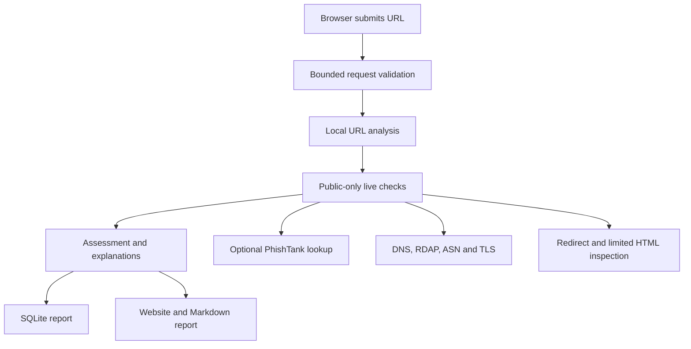

# Link Safety

> Pause before you click.

Link Safety checks a website address for common phishing and impersonation clues. It combines local URL rules with small, time-limited checks of public websites and security data. Each result explains what was checked and what could not be checked.

**Project status:** early prototype. The score is not calibrated and no result can guarantee that a link is safe.

## Contents

- [1. Introduction](#1-introduction)
- [2. How to use it and run it safely](#2-how-to-use-it-and-run-it-safely)
- [3. Deep dive: how it works](#3-deep-dive-how-it-works)
- [4. Security, scope, and project details](#4-security-scope-and-project-details)

## 1. Introduction

### The idea

Links can hide their destination with misspellings, encoded text, redirects, or convincing page content. Link Safety helps people review those signals before opening a link. Its goal is to make the checks understandable: show each finding, explain its meaning, and label unavailable checks honestly.

### What the project includes

- A dark, gold-accented website with an animated scan screen, score circle, results chart, and Markdown report export.
- URL checks for suspicious formatting, lookalike names, unusual encoding, file types, and redirect clues.
- Bounded live checks for public DNS, registry and ASN context, TLS, redirects, and returned page HTML.
- An optional PhishTank lookup. The full submitted URL is sent to PhishTank when the lookup runs.
- A SQLite report store with short retention and token-protected report retrieval.
- A Vodafone Cash support page.
- A Python backend. The browser interface remains HTML, CSS, and JavaScript.

This project is a learning-stage screening tool. It is not a full anti-phishing service, antivirus product, or safety certification.

## 2. How to use it and run it safely

### Requirements

- Python 3.13 or newer.
- `uv` for creating the isolated environment and installing the locked dependencies.
- PowerShell on Windows, or a shell with `uv` on PATH.

### Start locally

Open PowerShell in the project directory. Create `.env` from the example only if you do not already have your own file:

```powershell
if (-not (Test-Path .env)) { Copy-Item .env.example .env }
uv sync --locked
uv run python server.py
```

Open <http://127.0.0.1:3000>. The server listens on `127.0.0.1`, so it is available only on the same computer by default. Stop it with `Ctrl+C`.

### Scan a link safely

1. Open the local site and select **Scan a link**.
2. Enter a complete public `http://` or `https://` website URL.
3. Wait for the checks and review each result. `Clear` means that check found no obvious issue in the data it examined; it does not mean the site is guaranteed safe.
4. Copy the report as Markdown or download a `.md` file if you want to keep a local copy.

Do not submit a link containing a password-reset code, private access token, or other secret. The destination may receive a request. DNS resolvers receive its hostname, registry services receive domain or IP information, and PhishTank receives the exact URL when its check runs. Checks may be unavailable if a provider blocks a request or publishes no data.

### Configuration

Settings are read from `.env` and the process environment. Keep real keys in `.env` or a secrets manager and do not commit them.

| Setting | Default | What it controls |
|---|---:|---|
| `NODE_ENV` | `development` | Runtime mode (`development`, `test`, or `production`). The name stays for compatibility with the existing local configuration. |
| `PORT` | `3000` | Local HTTP port. |
| `BIND_ADDRESS` | `127.0.0.1` | Interface to listen on. Keep it local during development. |
| `ALLOWED_HOSTS` | `127.0.0.1,localhost` | Accepted HTTP Host names. Wildcards are rejected. |
| `DATABASE_PATH` | `./var/link-safety.sqlite` | SQLite database path. |
| `MAX_BODY_BYTES` | `8192` | Maximum JSON request body. |
| `MAX_URL_LENGTH` | `4096` | Maximum submitted URL length. |
| `RATE_LIMIT_WINDOW_MS` | `60000` | Rate-limit time window. |
| `RATE_LIMIT_MAX_REQUESTS` | `20` | Requests allowed per client address in that window. |
| `MAX_CONCURRENT_SCANS` | `2` | Number of scans allowed to run at once in one process. |
| `DATA_RETENTION_DAYS` | `30` | How long reports are kept, from 1 to 3650 days. |
| `PHISHTANK_APP_KEY` | empty | Optional PhishTank key. It may raise the provider's request limit. |

## 3. Deep dive: how it works

### Scan flow



1. **Validate the request.** The API accepts a JSON object with only a `url` field. It checks the request size and URL length, requires HTTP or HTTPS, and rejects credentials, invalid hosts, private IP literals, and non-standard ports.
2. **Check the URL locally.** Rules look for user-info masking, punycode, common brand-like strings, deep subdomains, encoded payload patterns, risky file extensions, and redirect parameters.
3. **Check live signals.** The server can check PhishTank, public DNS, domain age through RDAP, IP registry and ASN context, TLS, redirects, and a capped amount of page HTML. It follows no more than five redirects and validates every new destination. It does not run page scripts or open a browser.
4. **Explain the result.** Each check reports `clear`, `warning`, `pending`, `error`, or `blocked`. A warning affects the signal score. Missing or failed checks are counted as unavailable and are not treated as clear.
5. **Store a short-lived report.** SQLite stores the hostname, scheme, findings, score, verdict, timestamps, and a hash of a random report token. The raw URL path, query, fragment, and token are not stored.

### What each check can tell you

| Check area | What it checks | Limit |
|---|---|---|
| URL structure | Masking, punycode, known brand-like text, deep subdomains, encoding, file extensions, and redirect clues. | Rules are small heuristics and may miss attacks or flag harmless links. |
| Phishing reputation | Checks the exact submitted URL with PhishTank when available. | Provider rate limits or security challenges can make the result unavailable. A no-match does not prove safety. |
| Domain and network context | Public DNS, RDAP registration and IP registry records, and Team Cymru BGP origin. | Registry data is context, not proof of abuse or precise physical location. Some suffixes or addresses lack data. |
| TLS | Validates the HTTPS certificate chain and hostname. | HTTPS protects the connection; it does not prove that a site is trustworthy. |
| Redirects and page content | Follows up to five redirects and inspects at most 384 KiB of HTML for password forms, form destinations, urgency, brand clues, hidden controls, and simple response differences. | It does not execute JavaScript, render a browser, or detect every client-side redirect or visual trick. |
| Display label | Explains that no link label was supplied for comparison. | The input accepts a URL only; it cannot compare that URL with copied message text. |

### Verdict and score

The score is an **uncalibrated URL signal score**, not the probability that a link is safe. Warnings lower the score. Three or more warning signals produce `high`; one or two produce `caution`. No warnings with unavailable checks produce `incomplete`. `clear` is used only when all checks that ran completed without a warning. Always read the detailed findings.

### API routes

| Route | Purpose |
|---|---|
| `POST /api/analyze` | Compatibility route used by the bundled website. |
| `POST /api/v1/scans` | Creates a report and returns its one-time bearer token. |
| `GET /api/v1/scans/{scan_id}` | Reads a stored report using `Authorization: Bearer <access_token>`. |
| `GET /health/live` | Reports that the process is running. |
| `GET /health/ready` | Checks whether SQLite responds. |

### Project layout

```text
backend/link_safety/    Python API, rules, outbound checks, and SQLite adapter
public/                 Browser interface (HTML, CSS, JavaScript)
migrations/             Ordered SQLite schema migrations
tests/                  Python unittest checks
docs/                   Setup, architecture, API, and operations notes
project engineering ideas/  Original project and architecture references
var/                    Local SQLite data (ignored by Git)
archive/                 Preserved Node.js backend from before the migration
```

## 4. Security, scope, and project details

### Current security controls

- The server binds to loopback by default, restricts accepted Host names, disables proxy-header trust, and does not enable cross-origin requests.
- Request bodies, URL length, request rate, concurrent scans, outbound time, redirects, and response bytes are limited.
- Live checks accept standard HTTP/HTTPS ports only. Every resolved A and AAAA address must be public, and each outbound socket connects to an address that was checked. Redirects go through the same policy again.
- HTTPS verifies the certificate chain and host name. The server sends no cookies or credentials and does not execute remote JavaScript.
- SQLite uses ordered migrations, foreign keys, strict tables, transactions, defensive settings where available, parameterized queries, and owner-only file/sidecar permissions on POSIX.
- Stored report access uses a random 256-bit token. The database contains only its SHA-256 hash and token comparison is constant time.
- Logs include a request ID and route label but omit the URL, body, query, client IP, and bearer token.
- Reports expire after 30 days by default.

### Privacy and data sharing

The full URL is used in memory for the scan and is returned to the browser for the immediate result. The exact URL is sent to PhishTank when that provider lookup runs. DNS resolvers receive the hostname. The public destination receives bounded page/TLS requests. IANA/RIR RDAP and Team Cymru receive domain or IP details for context. Stored reports keep the hostname and findings, not the path, query, or fragment. Avoid submitting secret-bearing links.

### Scope and known limits

- This is an early prototype, not a safety guarantee or a production security certification.
- The score has not been tested or calibrated against a representative phishing dataset.
- Provider access and registry coverage vary. Unavailable lookups remain marked as unavailable instead of being shown as clean.
- Static HTML checks can miss JavaScript-driven behavior and may produce false alarms.
- The in-process rate limiter and local SQLite database are for a single process. They do not support horizontal scaling.
- Application-level SSRF protections are not a substitute for an OS-level network egress firewall. Public deployment needs an isolated inspection worker and strict egress rules.
- Production also needs HTTPS ingress, shared rate limiting, encrypted backups, restore testing, monitoring, incident ownership, and an independent security review.

### Verify the Python backend

```powershell
uv run python -m unittest discover -s tests -p "test_*.py" -v
```

The suite covers URL policy, IP transition-address rejection, SSRF-safe DNS and redirects, HTML inspection, SQLite permissions/migrations/token storage, configuration, rate limiting, and the API response contract. It does not certify the application or replace an independent penetration test.

### Project metadata

| Item | Details |
|---|---|
| Version | `0.3.0` |
| Backend | Python 3.13+ with FastAPI and Uvicorn |
| Browser UI | HTML, CSS, and JavaScript |
| Database | SQLite at `var/link-safety.sqlite` by default |
| Default address | `127.0.0.1:3000` |
| License | No license file is included yet. Add one before inviting reuse. |

### Support the project

If Link Safety has helped you and you would like to support its development, Vodafone Cash transfers in Egypt can be sent to **+201031263934**. From a Vodafone line, dial `*9*7#`, choose **Money Transfer**, enter the number and amount, then confirm the recipient details. Never share your wallet PIN.

### Documentation

- [Local setup](docs/development/local-setup.md)
- [Architecture overview](docs/architecture/overview.md)
- [Backend architecture](docs/architecture/backend.md)
- [Data model](docs/architecture/data.md)
- [Security architecture](docs/architecture/security.md)
- [API contract](docs/api/openapi.yaml)
- [Operations runbook](docs/operations/runbook.md)
- [Architecture decisions](docs/architecture/decisions/)
