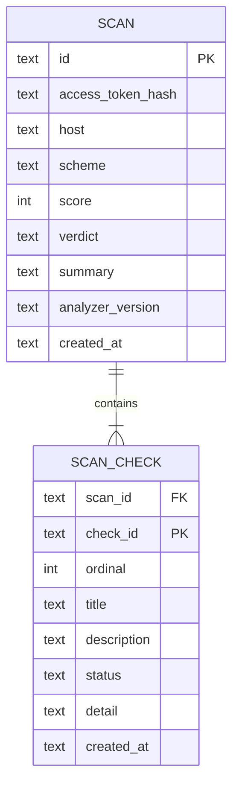

# Data model and lifecycle

## Storage decision

Use one relational store initially. SQLite is appropriate for a local single-process MVP with small transactional records and no deployment service to operate. It is the only source of truth. WAL, foreign keys, `STRICT` tables, check constraints, indexes, prepared statements, and ordered SQL migrations are enabled. This SQLite adapter is not a multi-node database plan; use PostgreSQL or another managed relational store before horizontal scaling or a production availability commitment. The application does not encrypt the SQLite file itself; production storage and backups must use platform encryption and tight filesystem/service access.

## Conceptual model

- **Scan:** one analysis operation with identity, hostname, URL scheme, score, verdict, summary, analyzer version, and creation time.
- **Scan check:** one finding within a scan, with stable check ID, display title, explanatory text, status, detail, and presentation order.
- **Report credential:** a random 256-bit bearer token returned once to the caller; only its SHA-256 digest is stored with the scan.

## Data dictionary

| Field | Meaning | Classification | Lifecycle |
|---|---|---|---|
| `scan.id` | Random report identifier | Internal | Deleted with report |
| `scan.access_token_hash` | SHA-256 of a random 256-bit report credential | Restricted | Deleted with report; raw token is never persisted |
| `scan.host` | Parsed hostname only | Confidential | 30 days by default |
| `scan.scheme` | Parsed URL scheme | Internal | 30 days by default |
| `scan.score`, `verdict`, `summary` | Derived static findings | Confidential | 30 days by default |
| `scan.analyzer_version` | Rule-set version for provenance | Internal | 30 days by default |
| `scan.created_at` | UTC ISO-8601 time | Internal | 30 days by default |
| `scan_check.*` | Check identity, status, explanation, detail, order | Confidential | 30 days by default |

The original URL, path, query, fragment, submitted body, client IP, and raw bearer token are not written to the database or structured logs. The current local analyzer emits details based on URL structure and hostname. Any new analyzer field must pass a data-minimization review before persistence.

## Integrity, transactions, and reads

The scan and all check rows are inserted in one `BEGIN IMMEDIATE` transaction. Foreign keys cascade deletion. Database constraints enforce score range, check order uniqueness, and allowed statuses/verdicts. Report lookups use the scan ID and then verify the bearer-token digest in constant time. No list/history API exists.

## Retention and deletion

`DATA_RETENTION_DAYS` defaults to 30 and is bounded from 1 to 3650. A cleanup runs at startup and every six hours. SQLite WAL sidecar files are runtime data and ignored by Git. Backups, if configured by an operator, inherit the same classification and retention obligations; deleting the primary record does not immediately erase older backup copies.

## Migrations and recovery

Migrations are ordered `NNNN_name.sql` files and their applied names are tracked in `schema_migrations`. Changes should follow expand/migrate/verify/contract when old and new app versions overlap. Before production, choose business RPO/RTO, encrypted backup storage, independent credentials, restore steps, and a tested restore schedule. These targets are intentionally unset until the deployment owner defines impact requirements.

