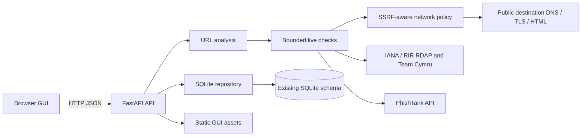

# Architecture overview

## Product boundary

The service accepts a URL, inspects syntactic signals, makes bounded live checks against the public destination and registries, records a short-lived report, and returns an explanation for each check. The browser UI is served by the same origin. The destination response is never executed as a browser page.

## Logical architecture

The runtime is one modular monolith. The API module coordinates the analyzer and repository; live checks use the network-policy module for outbound requests. The original Node backend is archived for reference and is not loaded at runtime. Live inspection is constrained in application code and is a local-MVP feature; a production deployment still needs an isolated worker and egress firewall.

## Trust boundaries

1. Browser to API: untrusted JSON, bounded and schema-checked; rate-limited; no cookies or CORS credentials.
2. API to analysis: URL normalization and static risk rules run before remote inspection.
3. API to persistence: prepared statements and a single transaction for scan plus check rows.
4. Live checks to external destinations: strict URL scheme/port checks, public DNS resolution, address pinning, redirect revalidation, response caps, and short timeouts. No private/reserved destination should be contacted.
5. API to browser: HTML/JSON with CSP and security headers; detailed reports require a 256-bit bearer token.

## Operational shape

Local development binds to loopback and uses one SQLite file. Production must explicitly configure the bind address, TLS termination, edge rate limiting, backups, monitoring, and recovery objectives. Horizontal replicas are not supported by the in-memory limiter or SQLite file layout.
