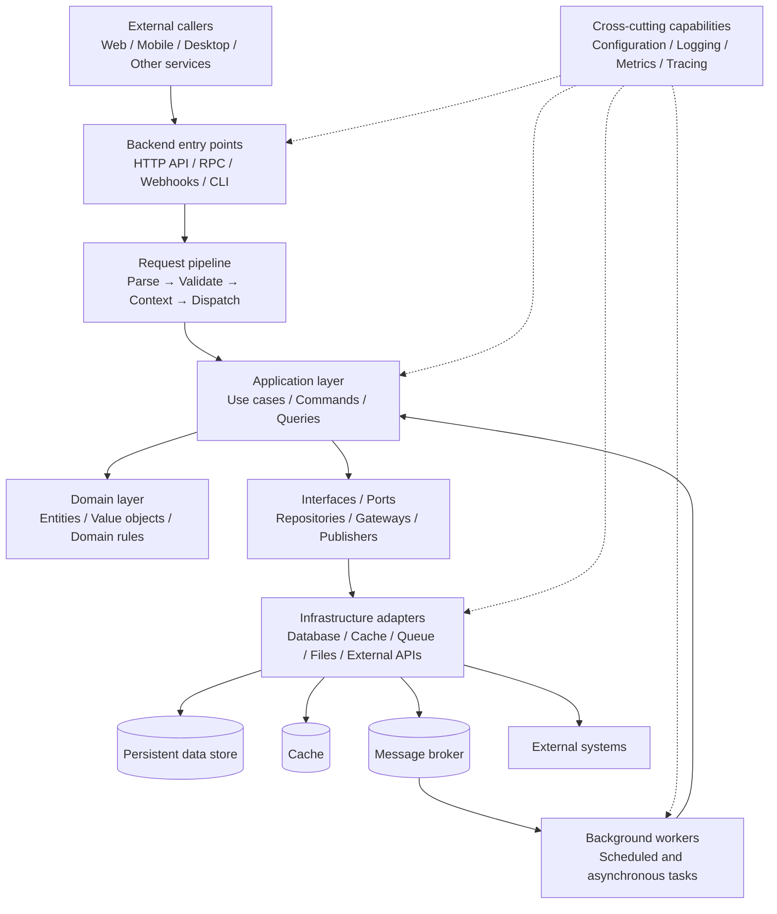
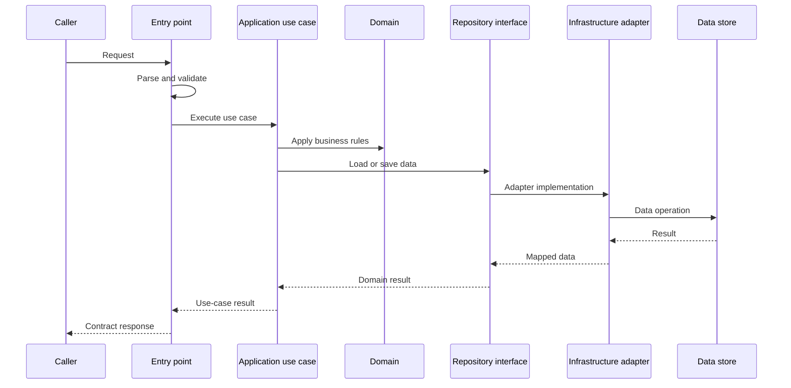

# Universal Backend Architecture (USBA)

**Version:** 1.0  
**Purpose:** A reusable, technology-independent backend architecture baseline for web applications, desktop applications with a backend service, mobile backends, APIs, SaaS products, automation platforms, and enterprise systems.

> This document covers the backend only. It does not prescribe a frontend/GUI design or replace a separate security architecture. Security controls should be applied across the components described here.

---

## 1. Architectural goals

The backend should provide a reliable, understandable, testable, and evolvable foundation for the application's business capabilities.

Every project should aim for these properties:

1. **Clear separation of concerns** — transport, application orchestration, business rules, and technical integrations have distinct responsibilities.
2. **Low coupling** — a change in one module should not unnecessarily force changes across unrelated modules.
3. **High cohesion** — code that implements one business capability should live together.
4. **Explicit contracts** — modules and external consumers communicate through documented interfaces and schemas.
5. **Business logic independence** — core business rules should not depend directly on a web framework, database driver, or cloud provider.
6. **Predictable behavior** — requests, errors, transactions, retries, and background jobs follow defined rules.
7. **Testability** — business behavior can be tested without starting the entire system.
8. **Operational visibility** — failures, latency, workload, and important business events can be observed.
9. **Controlled evolution** — the architecture can grow without introducing distributed-system complexity prematurely.
10. **Fit to the project** — optional components are introduced only when the requirements justify them.

## 2. Recommended default architecture

For most new projects, begin with a **modular monolith**: one deployable backend application organized into independent business modules with explicit boundaries.

A modular monolith is a starting point, not a permanent restriction. Separate services only when there is a concrete reason, such as independent scaling, independent deployment, strong fault isolation, separate ownership, or a requirement for a different runtime.

### 2.1 Logical architecture



### 2.2 Layer responsibilities

| Layer | Main responsibility | Must not become |
|---|---|---|
| Entry points | Receive requests or events and translate them into application calls | A place for business rules or database queries |
| Request pipeline | Parse, validate, enrich, and route incoming work | A second business-logic layer |
| Application | Coordinate use cases, transactions, and workflows | A collection of framework-specific controllers |
| Domain | Own business concepts, rules, and invariants | A wrapper around database tables |
| Ports / interfaces | Define what the application needs from technical services | An implementation of a specific vendor SDK |
| Infrastructure adapters | Implement database, cache, queue, file, and external-service access | The owner of business policy |
| Workers / schedulers | Execute asynchronous and time-based work | An uncontrolled second application |
| Cross-cutting capabilities | Provide shared technical capabilities consistently | A global dumping ground for unrelated functions |

## 3. Dependency and module rules

Use these rules to keep the architecture maintainable:

- Dependencies should point inward: entry points and infrastructure depend on application/domain contracts, not the other way around.
- The domain layer should not import web frameworks, database libraries, queue clients, or vendor SDKs.
- Application use cases should depend on interfaces for persistence and external services.
- Infrastructure implements those interfaces and is wired into the application at startup.
- A module should not reach into another module's private implementation or tables directly.
- Shared code should contain genuinely reusable technical capabilities, not business logic that belongs to a particular module.
- Avoid circular dependencies between modules.
- Keep module interfaces small and explicit.
- Prefer synchronous in-process calls inside a modular monolith. Use messages for work that genuinely needs asynchronous execution or independent delivery.

### 3.1 Business modules

Organize the backend around **business capabilities**, not only technical file types.

Examples:

- `accounts`
- `billing`
- `orders`
- `inventory`
- `notifications`
- `reporting`
- `projects`
- `link_analysis`

The actual modules depend on the project's domain. Do not create modules just because they appear in this example.

Each module should own its use cases, domain rules, data-access contracts, and module-specific tests. Other modules should interact through its public application interface or published events.

## 4. Standard request lifecycle

A typical synchronous request should follow a predictable path:

1. **Receive** — the entry point receives the request and identifies the operation.
2. **Parse** — convert transport data into a typed request or command.
3. **Validate** — check structure, types, formats, and request constraints.
4. **Build context** — establish request ID, caller context, locale, and other required metadata.
5. **Authorize** — enforce the applicable access policy before performing the operation. Detailed controls belong to the security architecture.
6. **Dispatch** — call the appropriate application use case.
7. **Execute** — application logic coordinates domain behavior and required ports.
8. **Persist** — apply changes through repositories and transaction boundaries where needed.
9. **Publish or schedule** — record events or enqueue follow-up work when required.
10. **Respond** — map the result to a stable response contract.
11. **Observe** — record appropriate logs, metrics, and traces throughout the operation.



Not every operation needs every step. Keep the flow consistent while avoiding unnecessary layers for simple applications.

## 5. Entry points and transport adapters

The backend may expose one or more entry points:

- **HTTP/REST API** — a common choice for web and mobile clients and public integrations.
- **GraphQL** — useful when clients need flexible, related data selection and the team can manage its complexity.
- **RPC** — useful for strongly defined service-to-service operations.
- **Webhooks** — receive events from external systems.
- **CLI or command interface** — support administration, automation, and maintenance tasks.
- **Message consumers** — receive asynchronous messages from a broker.

Keep transport-specific details at the boundary. The application use case should not need to know whether it was invoked by HTTP, a CLI command, or a message consumer.

Entry points should translate transport requests into application commands/queries and translate application results into transport responses.

## 6. Application layer: use cases and workflows

The application layer coordinates what the system does. It should express operations in terms of the project's business capabilities.

Examples:

- `RegisterAccount`
- `CreateOrder`
- `ApprovePayment`
- `GenerateReport`
- `AnalyzeSubmittedLink`

A use case typically:

1. Receives a validated command or query.
2. Loads the data it needs through repository interfaces.
3. Checks application-level preconditions.
4. Invokes domain behavior.
5. Coordinates transactions and external operations.
6. Saves resulting changes.
7. Returns a result or a well-defined application error.

Keep use cases focused. If a method coordinates unrelated workflows, split it into smaller use cases.

### 6.1 Commands and queries

- A **command** requests a state change, such as creating an order.
- A **query** requests information without changing state, such as retrieving an order summary.

Keeping these intentions clear improves API design, testing, and transaction handling. Full Command Query Responsibility Segregation (CQRS) is optional; do not introduce separate read/write databases unless the scale or workload justifies them.

## 7. Domain layer: business rules

The domain layer represents the concepts and rules that make the project what it is.

It may contain:

- **Entities** — objects with identity and lifecycle.
- **Value objects** — immutable values defined by their attributes.
- **Aggregates** — consistency boundaries for related domain objects.
- **Domain services** — business operations that do not naturally belong to one entity.
- **Domain events** — facts that have occurred in the business domain.
- **Invariants** — rules that must always remain true.

Examples of domain rules:

- An order cannot be shipped before it is paid, unless an explicit business rule permits it.
- A reservation cannot exceed available capacity.
- A user cannot redeem an expired voucher.

The domain should not know how data is stored, how an HTTP request is represented, or which cloud provider hosts the system.

Do not force domain-driven design terminology into a very small CRUD application where it adds no value. Keep the underlying separation of concerns even when the domain model is simple.

## 8. Data access and persistence

Treat persistence as an infrastructure capability accessed through clear application-facing interfaces.

### 8.1 Repository responsibilities

A repository or data-access component should:

- Load and save the data required by a use case.
- Map stored records to application/domain representations.
- Apply query constraints and pagination.
- Handle persistence-specific concerns.
- Avoid embedding unrelated business workflows.

### 8.2 Persistence guidelines

- Choose a storage technology based on data shape, consistency needs, query patterns, scale, and operational capability.
- Keep database-specific query code inside infrastructure adapters.
- Use explicit transaction boundaries for operations that must succeed or fail together.
- Enforce important data invariants at the appropriate application and persistence layers.
- Avoid exposing raw database models as public API contracts.
- Avoid one universal repository abstraction that hides useful database capabilities.
- Use migrations as controlled, reviewable changes to the data model.
- Define how schema changes remain compatible with running application versions.

### 8.3 Transaction boundaries

A transaction should cover the smallest unit of work that must be atomic.

For a workflow that changes multiple records in the same database, use a database transaction where appropriate. Do not keep a transaction open while waiting for slow external network calls.

For workflows spanning multiple independent systems, a single database transaction usually cannot cover everything. Use an explicit workflow, compensating actions, or a saga-style process where the business requires it.

## 9. Background processing and asynchronous work

Use background workers for tasks that should not block the caller or that need independent scheduling and retry behavior.

Examples:

- Sending notifications.
- Generating large reports.
- Processing uploaded files.
- Running scheduled maintenance.
- Performing long-running analysis.
- Synchronizing with external systems.

### 9.1 Queue and worker design

A typical flow:

1. The application records the business change.
2. It records or enqueues the work to be performed.
3. A worker receives the task.
4. The worker validates the message and executes the handler.
5. The worker acknowledges successful completion.
6. Failed work follows a defined retry or dead-letter policy.

Design workers to tolerate duplicate message delivery. Prefer idempotent handlers so processing the same task more than once does not create duplicate business effects.

### 9.2 Reliability requirements

- Set bounded retry counts.
- Use exponential backoff with jitter where suitable.
- Distinguish transient failures from permanent failures.
- Use dead-letter handling for messages that cannot be processed.
- Track task status and processing duration.
- Define timeouts and resource limits.
- Make long-running jobs resumable where practical.
- Avoid silently dropping failed work.
- Use an outbox pattern when a database update and event publication must remain consistent.

Do not add a message broker to every project. A simple in-process task or scheduled job may be sufficient for a small application.

## 10. External service integrations

All external systems should be accessed through dedicated adapters or clients.

Examples include payment providers, email services, identity providers, analytics services, AI APIs, shipping services, and third-party data sources.

Each integration should define:

- Its interface and supported operations.
- Request and response mapping.
- Authentication configuration supplied by the platform's configuration/secrets mechanism.
- Connection and response timeouts.
- Retry rules for operations that are safe to retry.
- Error mapping.
- Rate-limit handling.
- Observability and correlation identifiers.
- Contract or integration tests.

Use resilience patterns where appropriate:

- **Timeouts** prevent indefinite waiting.
- **Retries** handle selected temporary failures; avoid retrying non-idempotent operations blindly.
- **Circuit breakers** temporarily stop calls to a failing dependency.
- **Bulkheads** limit the resources consumed by one dependency.
- **Fallbacks** provide a defined alternative only when that alternative preserves correct business behavior.

Do not let vendor-specific response objects spread throughout the domain and application layers.

## 11. Caching

Caching is an optimization, not the primary source of truth unless the product explicitly defines it that way.

Use caching when measurements show that repeated reads or expensive computations justify it.

Define for each cache:

- What is cached.
- The cache key and scope.
- Expiration or invalidation behavior.
- Maximum size or eviction strategy.
- What happens on a cache miss or outage.
- Whether stale data is acceptable.
- How user- or tenant-specific data is kept separate.

Common patterns:

- **Cache-aside** — read from cache, then load from the data store on a miss.
- **Write-through** — update the cache as part of the write flow.
- **Time-based caching** — expire data after a defined period.

Avoid caching sensitive or rapidly changing data without a clear correctness model. Measure hit rate, latency, and memory use.

## 12. API and internal contracts

Every boundary should have an explicit contract.

For public or client-facing APIs, document:

- Endpoint or operation name.
- HTTP method or transport operation.
- Request schema.
- Response schema.
- Validation rules.
- Expected errors.
- Pagination and filtering behavior.
- Authentication/authorization expectations, defined by the security architecture.
- Versioning and compatibility policy.
- Rate and payload limits where applicable.

### 12.1 API design conventions

- Use consistent naming and response structures.
- Use appropriate HTTP status codes for HTTP APIs.
- Use stable identifiers rather than exposing database implementation details.
- Define pagination for collection endpoints.
- Define filtering and sorting explicitly.
- Avoid returning unnecessary internal fields.
- Avoid changing existing response meanings silently.
- Publish and maintain an API specification, such as OpenAPI, when building HTTP APIs.

### 12.2 Error contract

Return errors that are useful to clients without exposing internal implementation details.

A common shape is:

```json
{
  "error": {
    "code": "RESOURCE_NOT_FOUND",
    "message": "The requested resource was not found.",
    "request_id": "req_12345",
    "details": []
  }
}
```

The values above are illustrative. Keep error codes stable and document which errors callers may act upon.

Internally, preserve the diagnostic cause in logs/traces while returning a safe, predictable response externally.

## 13. Validation, errors, and application boundaries

Validation should occur at more than one level because each level answers a different question:

- **Transport validation:** Is the incoming request well-formed?
- **Application validation:** Is this operation valid in the current application context?
- **Domain validation:** Does the operation preserve the business rules?
- **Persistence constraints:** Can the data store enforce additional integrity guarantees?

Use typed or categorized errors rather than relying on arbitrary strings.

A useful error taxonomy includes:

- Validation errors.
- Not-found errors.
- Conflict errors.
- Business-rule errors.
- Dependency errors.
- Timeout errors.
- Unexpected internal errors.

Map these errors to the relevant transport contract at the entry point. Do not make the domain depend on HTTP status codes.

## 14. Configuration and environment management

Configuration should be explicit, validated at startup, and separated by environment.

Typical environments:

- Local development.
- Automated test.
- Staging or pre-production.
- Production.

Guidelines:

- Keep environment-specific settings outside business logic.
- Validate required settings during startup rather than failing unpredictably later.
- Use typed configuration objects where supported.
- Avoid hidden defaults for critical settings.
- Keep feature flags distinct from permanent business rules.
- Document configuration ownership and expected values.
- Keep credentials and sensitive values in a dedicated secrets mechanism, as defined by the security architecture.

## 15. Observability and operational visibility

The backend should expose enough information to understand normal behavior and diagnose failures.

### 15.1 Logs

Use structured logs with consistent fields, such as:

- Timestamp.
- Severity.
- Service/application name.
- Environment.
- Request or correlation ID.
- Operation or route.
- Outcome.
- Duration.
- Relevant non-sensitive context.

### 15.2 Metrics

Track, where relevant:

- Request count and throughput.
- Error rate.
- Latency percentiles.
- Database query duration and connection pool usage.
- Queue depth and job age.
- Worker success/failure rate.
- External dependency latency and errors.
- Cache hit/miss rate.
- Resource utilization.

### 15.3 Distributed tracing

Use trace and span context across service calls, database operations, queue publishing, and worker processing when the system has multiple components or asynchronous workflows.

Logs, metrics, and traces should use compatible correlation identifiers while avoiding sensitive data.

## 16. Performance and scalability

Design for measured requirements rather than assumed traffic.

Start with:

- Efficient queries and suitable indexes.
- Bounded database connection pools.
- Pagination for large result sets.
- Request and dependency timeouts.
- Bounded concurrency.
- Appropriate caching based on measured access patterns.
- Efficient serialization and payload sizes.
- Background processing for long-running tasks.
- Load and stress testing for important workloads.

Scale in this order where appropriate:

1. Measure and identify the bottleneck.
2. Fix inefficient algorithms, queries, and resource use.
3. Add suitable caching or asynchronous processing.
4. Increase resources or run multiple stateless application instances.
5. Separate a module into a service only when independent scaling, deployment, ownership, or isolation is worth the operational cost.

Do not assume that microservices automatically make a system faster or more reliable.

## 17. Testing architecture

Testing should follow the architecture's boundaries.

| Test type | What it verifies |
|---|---|
| Unit tests | Domain rules and small isolated functions |
| Application tests | Use-case behavior and workflow decisions |
| Integration tests | Database, cache, queue, and adapter behavior |
| Contract tests | Agreement between API or module consumers and providers |
| End-to-end tests | Critical workflows through real entry points |
| Performance tests | Latency, throughput, and resource behavior under load |
| Failure tests | Timeout, retry, dependency outage, and recovery behavior |

Guidelines:

- Test business rules without requiring a running database whenever practical.
- Use real infrastructure or faithful test instances for important persistence and integration behavior.
- Test failure paths, not only successful paths.
- Test duplicate background messages and retry behavior.
- Keep tests deterministic and isolate test data.
- Avoid making every test an end-to-end test; use the smallest test scope that proves the behavior.

## 18. Suggested backend code organization

The exact folders depend on the language and framework. The following is a conceptual example for a modular backend:

```text
backend/
├── application/
│   ├── modules/
│   │   ├── accounts/
│   │   │   ├── domain/
│   │   │   ├── application/
│   │   │   ├── ports/
│   │   │   ├── infrastructure/
│   │   │   └── tests/
│   │   ├── billing/
│   │   └── notifications/
│   ├── shared/
│   │   ├── errors/
│   │   ├── contracts/
│   │   └── utilities/
│   └── bootstrap/
│       ├── configuration/
│       └── dependency_wiring/
├── interfaces/
│   ├── http/
│   │   ├── routes/
│   │   ├── handlers/
│   │   ├── schemas/
│   │   └── middleware/
│   ├── webhooks/
│   └── cli/
├── workers/
│   ├── handlers/
│   └── schedules/
├── infrastructure/
│   ├── persistence/
│   ├── messaging/
│   ├── cache/
│   ├── external_services/
│   └── observability/
├── migrations/
├── tests/
│   ├── integration/
│   ├── contract/
│   └── end_to_end/
└── README.md
```

This is an organizational example, not a required folder structure. In a smaller project, fewer folders may be clearer. Avoid empty abstraction layers created only to match a template.

## 19. Architecture decisions to make for each new project

Before implementation, answer these backend-specific questions:

1. What business capabilities should become separate modules?
2. Which entry points are required: HTTP, RPC, webhooks, CLI, or messages?
3. Which operations are commands and which are queries?
4. What are the core domain entities, rules, and consistency boundaries?
5. What data needs to be persisted, and what storage model best fits it?
6. Which operations require transactions?
7. Which tasks should run asynchronously or on a schedule?
8. Which external systems must be integrated?
9. What API contracts and compatibility policy are required?
10. Is caching justified by measured usage patterns?
11. What workload, latency, and availability targets matter?
12. What logs, metrics, traces, and alerts are needed?
13. What tests prove the critical workflows and failure behavior?
14. What components can remain in one deployable backend, and what evidence would justify separating them?

Record important choices in short Architecture Decision Records (ADRs): context, decision, alternatives considered, consequences, and date.

## 20. Reusable backend implementation checklist

### Before implementation

- [ ] Identify business capabilities and module boundaries.
- [ ] Define domain concepts and critical business rules.
- [ ] Select required backend entry points.
- [ ] Define API and internal contracts.
- [ ] Choose persistence and transaction approach.
- [ ] Identify asynchronous and scheduled workloads.
- [ ] Identify external integrations.
- [ ] Define expected workload and operational targets.

### During implementation

- [ ] Keep transport logic out of business rules.
- [ ] Implement use cases as focused application operations.
- [ ] Keep domain rules independent of frameworks and vendors.
- [ ] Access infrastructure through clear interfaces where useful.
- [ ] Define transaction boundaries.
- [ ] Standardize errors and responses.
- [ ] Make background handlers idempotent where duplicates are possible.
- [ ] Apply bounded timeouts, retries, and resource usage.
- [ ] Add structured logs and relevant metrics.
- [ ] Test modules and their important boundaries.

### Before release

- [ ] Verify API contracts and compatibility.
- [ ] Run unit, integration, contract, and critical workflow tests.
- [ ] Test dependency failures and timeout behavior.
- [ ] Verify migrations and rollback/forward-fix procedures.
- [ ] Verify background queues, retries, and dead-letter handling.
- [ ] Verify health and readiness reporting.
- [ ] Review performance against expected workloads.
- [ ] Confirm operational dashboards and alerts are useful.

### After release

- [ ] Monitor latency, errors, throughput, and resource usage.
- [ ] Review slow queries and failing integrations.
- [ ] Track queue delays and failed jobs.
- [ ] Review API usage and compatibility needs.
- [ ] Reassess module boundaries as the product evolves.
- [ ] Record significant architecture changes as ADRs.

---

## 21. Universal backend rules

1. Keep business rules out of transport handlers.
2. Keep domain logic independent of frameworks and infrastructure vendors.
3. Organize code around business capabilities, not only technical file types.
4. Define explicit interfaces at important module and infrastructure boundaries.
5. Keep transactions short and aligned with consistency requirements.
6. Treat asynchronous messages as potentially duplicated or delayed.
7. Make retries bounded and safe for the operation being retried.
8. Do not add a cache, queue, microservice, or abstraction without a clear requirement.
9. Make errors predictable and observable.
10. Measure performance before optimizing or distributing the system.
11. Test failure behavior as well as successful behavior.
12. Evolve the architecture incrementally and document important decisions.

## Final architectural principle

Build the simplest backend that satisfies the system's real requirements, but preserve clear boundaries so it can evolve safely. Start modular, keep business rules central, isolate technical details behind appropriate interfaces, and introduce distributed components only when measurable needs justify them.
