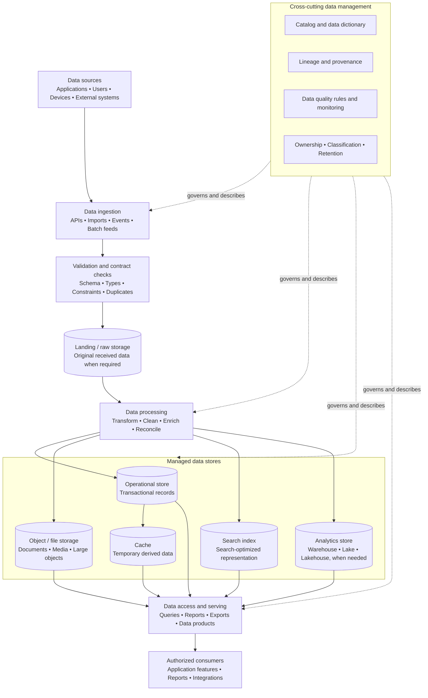
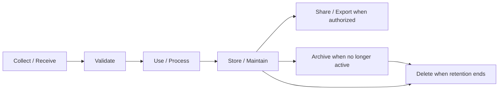

# Universal Data Architecture (USDA)

**Version:** 1.0  
**Purpose:** A reusable, technology-independent data architecture baseline for software systems, SaaS products, APIs, desktop and mobile applications with persistent data, analytics platforms, automation systems, and enterprise applications.

> This document covers data architecture only: how data is modeled, organized, stored, moved, validated, governed, accessed, evolved, and recovered. It does not prescribe a frontend, backend framework, deployment topology, or a complete security architecture. Apply the separate security architecture to every data component and data flow.

The architecture is a baseline, not a requirement to use every database, storage engine, or data platform. Choose components according to the project's data, workload, scale, reliability, privacy, and business requirements.

---

## 1. Architectural goals

A project's data architecture should make data understandable, trustworthy, available to authorized consumers, maintainable, and recoverable throughout its lifecycle.

Every project should aim for these properties:

1. **Clear data ownership** — Every important data domain has an accountable owner and a defined authoritative source.
2. **Consistent meaning** — Data definitions, units, identifiers, formats, and business rules are documented and used consistently.
3. **Fit-for-purpose storage** — Choose storage according to data shape, query patterns, consistency needs, scale, and operational complexity.
4. **Integrity by design** — Enforce important constraints as close as practical to the authoritative data store.
5. **Controlled data movement** — Every import, export, synchronization, transformation, and event flow has an explicit contract.
6. **Data quality** — Validate accuracy, completeness, validity, uniqueness, consistency, and timeliness according to business needs.
7. **Lifecycle management** — Define how data is collected, used, retained, archived, exported, and deleted.
8. **Traceability** — Record relevant metadata, provenance, transformations, and lineage so data can be understood and investigated.
9. **Evolvability** — Change schemas and data contracts in a controlled, compatible, testable way.
10. **Recoverability** — Set recovery objectives and prove that backups and restoration procedures work.
11. **Appropriate performance** — Design around real read/write patterns and measurable service expectations.
12. **Portability where valuable** — Avoid unnecessary dependence on a vendor-specific feature when portability is an actual requirement.

## 2. Foundational data architecture principles

1. **Model the domain before choosing the database.** Understand the entities, relationships, events, constraints, and access patterns before selecting a storage technology.
2. **Establish a source of truth.** Each critical fact should have a clearly defined authoritative owner. Replicas, caches, search indexes, and analytics copies are derived representations unless explicitly designated otherwise.
3. **Prefer the simplest suitable storage design.** A relational database is often a strong starting point for transactional business data. Add specialized stores only when a real workload or requirement justifies them.
4. **Separate operational and analytical workloads when needed.** Transaction processing and large-scale analytics have different access patterns and should not interfere with one another.
5. **Make data contracts explicit.** Define field meaning, types, requiredness, units, constraints, ownership, compatibility, and versioning for data exchanged between components or systems.
6. **Treat data as a managed asset.** Data needs owners, definitions, quality expectations, access rules, retention rules, and lifecycle responsibilities.
7. **Keep derived data rebuildable.** Caches, search indexes, materialized views, and analytics outputs should have documented source dependencies and rebuild procedures.
8. **Make consistency decisions explicit.** Decide which operations require immediate consistency and which can tolerate delayed propagation.
9. **Preserve history when the business requires it.** Define whether changes overwrite current values, create audit history, or create time-valid records.
10. **Minimize unnecessary duplication.** Duplicate data only for a defined reason, with a clear synchronization and conflict-resolution strategy.
11. **Design for deletion as well as storage.** Deletion must account for replicas, exports, caches, backups, indexes, and retention obligations.
12. **Measure data quality and reliability.** A successful database write does not necessarily mean the data is complete, correct, or useful.

## 3. Reference data architecture model

The following is a logical model. Small systems may combine several stages in one database or application. Larger systems may implement them as separate services or platforms.



### 3.1 Architecture stages

| Stage | Responsibility | Main design question |
|---|---|---|
| Data sources | Create or provide data | Who creates the data, and who owns its meaning? |
| Ingestion | Receive data from sources | How is data received, authenticated, throttled, and retried? |
| Validation | Check incoming data and contracts | Is the data structurally valid and acceptable? |
| Landing / raw storage | Preserve received data when required | Must the original input be retained for replay, audit, or reprocessing? |
| Processing | Clean, transform, enrich, and reconcile | Which rules turn source data into trusted data? |
| Operational storage | Maintain current business records | What must be read or changed reliably during normal operations? |
| Object / file storage | Store large or binary objects | Which files belong in object storage rather than database rows? |
| Derived stores | Support specialized access patterns | Which representations can be rebuilt from authoritative data? |
| Analytics storage | Support reporting and analysis | Do reporting workloads need a separate analytical platform? |
| Serving | Provide approved data views and exports | Which consumers need which data, in what shape and freshness? |
| Governance | Define ownership, meaning, quality, and lifecycle | Who is accountable for the data and its rules? |

Not every project needs a landing zone, analytics platform, search index, or separate processing system. Avoid adding stages without a requirement.

## 4. Data domains, ownership, and source of truth

Organize important information into recognizable business data domains. A domain is a group of data with related meaning and responsibility.

Examples include:

- Identity and accounts.
- Customers or users.
- Products and inventory.
- Orders and transactions.
- Payments and invoices.
- Content and documents.
- Devices and telemetry.
- Configuration and reference data.

For every important domain, define:

| Item | Required definition |
|---|---|
| Domain name | A clear business name |
| Data owner | Person or team accountable for meaning and quality |
| Authoritative source | System or store that owns the canonical record |
| Main entities | Core objects represented in the domain |
| Consumers | Components, teams, or external systems that use the data |
| Sensitivity | Applicable data classification |
| Quality rules | Required validity, completeness, and consistency checks |
| Lifecycle | Retention, archival, and deletion requirements |

### 4.1 Source-of-truth rules

- Identify the authoritative source for each critical fact.
- Do not let unrelated components independently edit the same master record without a defined ownership and conflict-resolution model.
- Treat replicas, caches, indexes, exports, and reporting tables as derived copies unless the architecture explicitly states otherwise.
- Document synchronization frequency and acceptable data delay.
- Define how conflicts are resolved when more than one source can update a record.
- Identify who can correct inaccurate source data.

### 4.2 Reference and master data

Reference data contains shared values used to interpret or classify other data, such as currencies, countries, status codes, categories, or measurement units.

Master data represents core business entities used across multiple processes, such as customers, products, suppliers, or locations.

For each shared data set, define its owner, identifiers, allowed values, update process, and distribution method. Avoid copying slightly different versions of the same reference list into unrelated modules.

## 5. Data modeling architecture

Design data at three complementary levels.

### 5.1 Conceptual data model

Describes the important business concepts and their relationships without committing to database tables or technology.

Questions to answer:

- What are the main business entities?
- What does each entity mean?
- How are entities related?
- Which facts are essential to the business?
- Which concepts are events, states, reference values, or documents?

### 5.2 Logical data model

Defines entities, attributes, relationships, cardinality, identifiers, and business constraints independently of a specific database engine.

Document:

- Entity and attribute names.
- Attribute definitions and units.
- Required and optional fields.
- Primary business identifiers.
- Relationships and cardinality.
- Uniqueness and domain constraints.
- Valid state transitions.
- Historical and temporal requirements.

### 5.3 Physical data model

Maps the logical model into the chosen storage technology.

Define:

- Tables, collections, objects, or graph structures.
- Column or field types.
- Primary and foreign keys where supported.
- Indexes and constraints.
- Partitioning where justified.
- Storage and access patterns.
- Replication and recovery configuration.

### 5.4 Modeling rules

- Use consistent naming conventions.
- Give every entity a stable identifier.
- Distinguish identifiers from display names, email addresses, and other changeable attributes.
- Define time zones and timestamp conventions explicitly; use a consistent internal representation and convert at presentation boundaries.
- Store money using an appropriate exact numeric representation and an explicit currency code; do not use binary floating-point for financial amounts.
- Store measurement values with their units or a documented unit convention.
- Define null, missing, unknown, and not-applicable semantics instead of treating them as interchangeable.
- Enforce critical uniqueness, referential, and value constraints in the authoritative store where possible.
- Avoid storing the same fact in multiple writable locations without an ownership and reconciliation plan.
- Use separate entities for concepts with independent identity, lifecycle, or relationships.
- Avoid overly generic fields and opaque JSON blobs when important fields need constraints, joins, reporting, or clear ownership.
- Use flexible JSON or document fields deliberately for genuinely variable structures, with validation and versioning.

### 5.5 Normalization and denormalization

Normalize transactional data to reduce unintended duplication and update anomalies. Denormalize only when a measured query, reporting, or distribution requirement justifies it.

When denormalizing:

- Identify the authoritative source fields.
- Define how derived values are refreshed.
- Decide whether updates are synchronous or asynchronous.
- Define behavior when refresh fails.
- Provide a rebuild or reconciliation process.
- Monitor drift between source and derived values.

## 6. Choosing data storage technologies

Select a store based on data characteristics and access patterns, not popularity. A single well-designed database is often the best initial choice.

| Storage type | Suitable use cases | Important considerations |
|---|---|---|
| Relational database | Structured business records, relationships, constraints, and transactions | Schema design, indexes, transaction boundaries, and query plans |
| Document database | Records with naturally variable or nested structures | Document growth, schema validation, cross-document relationships, and update patterns |
| Key-value store | Fast lookup by known key, session-like state, counters, or cache entries | Expiration, atomic operations, eviction, and durability requirements |
| Graph database | Data where multi-hop relationships are central to queries | Relationship modeling, traversal patterns, and operational complexity |
| Time-series database | High-volume timestamped measurements and telemetry | Retention, downsampling, cardinality, and time-based queries |
| Search engine / index | Full-text search, relevance ranking, and faceted search | Index is usually derived; define synchronization and rebuild procedures |
| Object / file storage | Images, videos, documents, archives, and large binary objects | Metadata, lifecycle, access patterns, integrity, and storage costs |
| Analytical warehouse | Structured reporting, dashboards, and analytical queries | Batch/stream ingestion, modeling, freshness, and workload separation |
| Data lake / lakehouse | Large-scale raw and processed data across varied formats | Cataloging, governance, file formats, schema evolution, and compute cost |

### 6.1 Storage selection decision process

Before selecting a technology, answer:

1. Is the data structured, semi-structured, unstructured, or a mixture?
2. What are the expected read and write patterns?
3. Are multi-record transactions required?
4. What consistency guarantees are required?
5. How are records related and queried?
6. How much data is expected now and later?
7. What latency and throughput are required?
8. What are the backup, recovery, retention, and availability requirements?
9. What operational skills and support are available?
10. What are the total hosting, licensing, maintenance, and migration costs?

Do not introduce multiple database technologies solely because the application has multiple modules. Polyglot persistence adds operational, consistency, backup, and monitoring complexity. Use it when the benefits are concrete.

## 7. Transactional data and database design

For operational business records, define how data is written, constrained, read, and updated.

### 7.1 Integrity constraints

Use the strongest suitable enforcement point for each invariant:

- Required fields and valid types.
- Unique identifiers and business keys.
- Referential relationships.
- Allowed value ranges and enumerations.
- Check constraints where supported.
- State-transition rules.
- Transaction-level invariants.

Application validation improves feedback and expresses business rules, while storage-level constraints protect the data from invalid writes through alternate code paths or concurrent operations.

### 7.2 Transactions

Group related changes into a transaction when they must succeed or fail together.

For every critical workflow, define:

- Which records must change atomically.
- What isolation level is required.
- How concurrent updates are handled.
- Whether optimistic or pessimistic locking is appropriate.
- What happens after a timeout or partial failure.
- Whether retries are safe.

Do not assume that a transaction spanning several independent services or databases is automatically atomic. Distributed workflows may require an explicit saga, compensation, or reconciliation design.

### 7.3 Concurrency and duplicate operations

For operations that may be retried or submitted more than once:

- Define an idempotency strategy where duplicate execution would be harmful.
- Use unique operation keys or business constraints where appropriate.
- Make state transitions conditional and atomic where possible.
- Define how conflicting updates are detected and resolved.
- Avoid relying only on a prior read to prevent concurrent writes.

### 7.4 Indexes and query design

- Add indexes to support measured query patterns and important constraints.
- Avoid indexing every field; indexes consume storage and slow writes.
- Review query plans for slow or high-volume queries.
- Select only required fields where practical.
- Use bounded pagination for large result sets.
- Avoid unbounded scans and unbounded relationship expansion.
- Review index maintenance and storage overhead as data grows.

## 8. Data access and serving patterns

Define how each type of consumer receives data without exposing storage internals or creating uncontrolled copies.

Common patterns include:

- **Operational queries:** Read current records for application operations.
- **Command/write operations:** Apply validated changes to authoritative records.
- **Read models:** Provide optimized views for specific query needs.
- **Exports:** Produce controlled snapshots or files for authorized consumers.
- **Search:** Query an index optimized for text and relevance rather than using the search index as the master record store.
- **Analytics:** Query curated data designed for reporting and analysis.

### 8.1 Read and write separation

Separate read and write models only when it makes the domain or performance requirements clearer. CQRS is an optional pattern, not a mandatory architecture.

If separate read models are used:

- Define their authoritative source.
- Define the update mechanism and expected freshness.
- Make eventual consistency visible to consumers where relevant.
- Provide replay or rebuild capability.
- Define behavior when projections fail or fall behind.

### 8.2 Query contracts

For important data access paths, document:

- Inputs and filters.
- Returned fields and meanings.
- Sort order.
- Pagination behavior.
- Consistency and freshness expectations.
- Maximum result size.
- Error and empty-result semantics.
- Data classification and permitted consumers.

## 9. Data consistency and distributed updates

Different data flows require different consistency guarantees. Choose deliberately rather than assuming all data is immediately consistent.

| Consistency model | Meaning | Suitable examples |
|---|---|---|
| Strong / immediate consistency | A successful write is visible according to the store's defined consistency guarantees | Balances, inventory reservation, critical account state |
| Eventual consistency | Replicas or derived views may temporarily lag but should converge | Search indexes, analytics dashboards, distributed read models |
| Read-your-writes | A user or process can observe its own successful update | User profile edits and workflow status displays |
| Monotonic / ordered processing | Observers do not move backward in an agreed sequence | Event sequence or versioned state updates |

For every important data flow, define acceptable staleness, ordering, duplicate handling, and conflict behavior.

### 9.1 Reliable event publication

If a database change must produce an event, avoid an unsafe design where the database write succeeds but event publication silently fails, or vice versa.

A transactional outbox is one common solution: record the business change and an event record in the same database transaction, then publish the event asynchronously. Consumers should handle duplicate delivery safely.

### 9.2 Event design

An event should describe a fact that has happened, not merely expose an internal database row.

Define:

- Unique event identifier.
- Event type and schema version.
- Occurrence timestamp and, where needed, source sequence.
- Relevant entity identifier.
- Producer identity.
- Payload meaning and units.
- Correlation or causation identifier where useful.
- Data classification and retention expectations.

Do not assume message delivery is exactly once. Design consumers to tolerate retries and duplicate delivery.

## 10. Data ingestion and integration

Use a controlled ingestion approach whenever data enters from users, files, devices, partner systems, external APIs, or other internal systems.

### 10.1 Ingestion modes

| Mode | Description | Suitable use |
|---|---|---|
| Synchronous request | Data is submitted and validated during a request | Small, immediate changes |
| Batch ingestion | Data arrives in scheduled groups | Imports, periodic feeds, bulk processing |
| Event-driven ingestion | Data arrives as discrete events | Business events and asynchronous integration |
| Stream ingestion | Continuous data flow | Telemetry, activity streams, real-time processing |
| Change Data Capture (CDC) | Changes are captured from a source data store | Replication and downstream data integration |

Choose the least complex mode that meets the latency, volume, and reliability requirements.

### 10.2 Ingestion controls

- Define a schema or contract for each source.
- Validate format, type, required fields, and permitted values.
- Authenticate and identify the source system.
- Apply size, rate, and resource limits.
- Deduplicate where sources may resend data.
- Record ingestion time and source metadata.
- Track accepted, rejected, and quarantined records.
- Preserve original input when replay or audit requirements justify it.
- Make retries bounded and safe.
- Provide a dead-letter or quarantine path for records that cannot be processed.
- Monitor freshness, volume, errors, and processing lag.

### 10.3 Transformation and reconciliation

For each transformation, document:

- Input and output schemas.
- Transformation rules.
- Default and null handling.
- Time-zone and unit conversions.
- Deduplication rules.
- Enrichment sources.
- Error handling.
- Version and owner.

For important feeds, reconcile totals, record counts, checksums, or business-level control totals so missing or duplicated data can be detected.

## 11. Data contracts and schema evolution

A data contract describes the structure and meaning of data exchanged between producers and consumers.

A useful contract defines:

- Field name and description.
- Data type and format.
- Required or optional status.
- Allowed values and constraints.
- Units, currency, and time semantics.
- Identifier meaning.
- Null and missing-value behavior.
- Sensitivity classification.
- Producer and consumer responsibilities.
- Version and compatibility rules.

### 11.1 Compatibility rules

- Prefer additive changes when possible.
- Do not silently change the meaning or unit of an existing field.
- Do not repurpose an identifier.
- Keep old and new consumers compatible during a planned transition.
- Version events and external data contracts deliberately.
- Test producers and consumers against representative contract fixtures.
- Publish a migration and retirement plan for breaking changes.

A schema registry or centralized contract catalog may help when many producers and consumers share event or data formats. It is optional for small systems.

## 12. Data quality architecture

Data quality should be measurable and tied to business importance.

### 12.1 Core quality dimensions

| Dimension | Question | Example check |
|---|---|---|
| Accuracy | Does the data represent reality correctly? | Reconcile a total against an authoritative source |
| Completeness | Are required values present? | Required customer fields are populated |
| Validity | Does the value follow the defined format and rules? | Date, currency, status, or range validation |
| Consistency | Do related records agree? | Order totals match line-item totals |
| Uniqueness | Are duplicates prevented or identified? | No duplicate business identifier |
| Timeliness | Is the data available within the required time? | Feed arrives within its freshness target |
| Integrity | Are relationships and constraints preserved? | No orphaned records where relationships are mandatory |

### 12.2 Quality controls

- Define quality rules with the data owner.
- Validate data at ingestion and at important transformation boundaries.
- Use database constraints for enforceable structural rules.
- Quarantine invalid records rather than silently discarding them when recovery is needed.
- Track quality failures and trends.
- Assign owners to investigate recurring defects.
- Define thresholds for blocking, warning, or accepting imperfect data.
- Monitor upstream changes that can affect data quality.

Not every field needs the same level of validation. Prioritize quality according to business impact and risk.

## 13. Metadata, catalog, and lineage

Metadata describes data so people and systems can find, understand, use, and govern it.

Maintain metadata appropriate to the scale of the project.

### 13.1 Metadata categories

- **Business metadata:** Meaning, owner, definitions, business terms, and permitted use.
- **Technical metadata:** Tables, columns, data types, formats, schemas, indexes, and storage locations.
- **Operational metadata:** Refresh time, job status, volume, errors, and freshness.
- **Governance metadata:** Classification, retention, access restrictions, and quality requirements.

### 13.2 Data dictionary

For important data fields, document:

| Field | Description |
|---|---|
| Name | Stable field or attribute name |
| Meaning | Business definition |
| Type | Data type and format |
| Requiredness | Required, optional, or conditionally required |
| Constraints | Allowed values, ranges, or uniqueness |
| Units | Currency, measurement unit, or time zone where relevant |
| Sensitivity | Data classification |
| Owner | Accountable domain or team |
| Source | Authoritative source or derivation |
| Retention | Applicable retention rule |

### 13.3 Lineage and provenance

Lineage explains where data came from and how it changed. Provenance records the origin and relevant history of a specific data item or dataset.

Track lineage where it matters for debugging, reporting trust, audits, regulatory requirements, or reproducibility. At minimum, understand the source and transformation path for critical derived datasets.

## 14. Data governance and lifecycle management

Data governance defines who may make decisions about data and which rules apply. It should be practical and proportional to the project.

### 14.1 Governance responsibilities

Assign responsibility for:

- Data ownership and definitions.
- Schema changes.
- Data quality rules.
- Access and permitted use.
- Reference and master data.
- Retention and deletion.
- Data sharing and exports.
- Incident investigation involving data.

### 14.2 Data classification

Use an appropriate classification scheme. A simple baseline is:

| Classification | Typical examples | Handling expectation |
|---|---|---|
| Public | Published documentation and public catalog data | May be shared publicly when approved |
| Internal | Internal operational data and non-public configuration | Limited to approved internal use |
| Confidential | Customer records, business-sensitive information | Restricted access and controlled sharing |
| Restricted | Credentials, highly sensitive records, regulated data | Strongly restricted handling and explicit oversight |

The project's security and privacy requirements determine the actual controls for each class.

### 14.3 Lifecycle stages



For each data category, define:

- Purpose of collection and processing.
- Minimum required fields.
- Authorized uses and consumers.
- Retention duration and its justification.
- Archive conditions and retrieval expectations.
- Deletion triggers and verification method.
- Treatment of replicas, caches, indexes, exports, and backups.
- Legal hold or preservation exceptions where applicable.

Do not retain data indefinitely by default. Do not promise immediate removal from immutable backups if the actual backup lifecycle does not support it; document the real deletion process and expiry window.

## 15. Operational data versus analytical data

Operational and analytical workloads often need different storage layouts and query strategies.

| Aspect | Operational processing (OLTP) | Analytical processing (OLAP) |
|---|---|---|
| Primary purpose | Run day-to-day business operations | Understand trends and support decisions |
| Typical operations | Insert, update, retrieve individual records | Aggregate and scan large datasets |
| Data shape | Current normalized records and transactions | Historical, integrated, analysis-oriented datasets |
| Query pattern | Short, selective, concurrent requests | Complex, broad, read-heavy queries |
| Design focus | Integrity, concurrency, predictable latency | Throughput, aggregation, history, and analytical flexibility |

A separate warehouse, lake, or lakehouse is not necessary for every product. Add one when reporting volume, historical analysis, data integration, or workload isolation justifies it.

### 15.1 Analytical data flow

A common analytical flow is:

1. Extract or receive data from authoritative sources.
2. Preserve raw inputs when replay or audit is needed.
3. Validate and transform the data.
4. Integrate related domains using documented keys and definitions.
5. Create curated datasets for known analytical needs.
6. Publish metrics and definitions consistently.
7. Monitor freshness, quality, and pipeline failures.

Do not let dashboards independently redefine important business metrics. Define shared metric meaning, calculation rules, filters, and time windows.

## 16. Caches, indexes, and derived data

Caches and indexes improve access patterns, but they introduce synchronization and stale-data risks.

### 16.1 Cache rules

- Treat a cache as derived or temporary unless it is explicitly designed as a durable authoritative store.
- Define the source of truth for every cached value.
- Choose expiration and invalidation behavior deliberately.
- Use bounded cache sizes and eviction policies.
- Prevent sensitive data from being cached beyond its permitted use.
- Handle cache misses and cache outages safely.
- Avoid relying on cache contents as the only copy of important data.
- Monitor hit rate, evictions, latency, and stale-data incidents.

### 16.2 Search indexes and materialized views

- Document the authoritative source and update mechanism.
- Expect indexing delays and partial failures.
- Make rebuilding possible.
- Define how deleted or restricted records are removed from derived representations.
- Monitor lag and missing records.
- Avoid accepting a search result as proof that the underlying authoritative record still exists or is accessible.

## 17. Schema changes and data migrations

Data structures change as requirements evolve. Manage schema changes as controlled releases.

### 17.1 Migration rules

- Store migration scripts in version control.
- Review migrations like application code.
- Test against realistic data volume and shape.
- Back up or establish a recovery point before high-risk changes.
- Estimate locks, runtime, storage growth, and application compatibility.
- Make migrations repeatable or safely detectable as already applied.
- Record migration status.
- Avoid destructive changes until dependent consumers have moved.

### 17.2 Expand-migrate-contract approach

For changes that must remain compatible across application versions:

1. **Expand:** Add the new schema element without immediately removing the old one.
2. **Migrate:** Update or backfill existing records and switch consumers gradually.
3. **Verify:** Confirm data completeness and consumer compatibility.
4. **Contract:** Remove obsolete elements only after the transition is complete and approved.

For large datasets, use bounded batches and checkpoints rather than one long transaction when appropriate.

### 17.3 Data backfills

For every backfill, define:

- Source and target datasets.
- Transformation logic and version.
- Batch size and throttling.
- Checkpoint and restart behavior.
- Idempotency and duplicate handling.
- Validation and reconciliation totals.
- Failure and rollback or compensation plan.

## 18. Backup, recovery, and availability

Data must be recoverable to a level appropriate for its business importance.

### 18.1 Recovery planning

Define:

- **RPO (Recovery Point Objective):** The maximum acceptable data loss measured in time.
- **RTO (Recovery Time Objective):** The target time to restore the required service or data capability.
- Backup frequency and retention.
- Point-in-time recovery requirements.
- Geographic or account separation requirements.
- Restore order and dependencies.
- Ownership of recovery actions.

Targets must come from business impact and service requirements, not from a generic template.

### 18.2 Backup rules

- Back up authoritative data and required metadata/configuration.
- Protect backups from unauthorized modification or deletion.
- Separate backup credentials from routine application credentials.
- Use encryption and access controls appropriate to the data.
- Define backup retention and expiry.
- Monitor backup job success and backup age.
- Verify integrity where practical.
- Test restoration regularly in a controlled environment.
- Document recovery steps and dependencies.

Replication improves availability but is not a substitute for backups. A deletion or corruption can replicate to every replica.

## 19. Data performance and scalability

Scale based on measurements and known bottlenecks. Do not add complex data infrastructure before observing a need.

### 19.1 Performance practices

- Establish baseline data volume, growth, and access patterns.
- Measure query latency and throughput.
- Inspect slow queries and query plans.
- Add or revise indexes based on actual workloads.
- Use bounded pagination and bulk operations carefully.
- Avoid repeatedly fetching the same data unnecessarily.
- Use connection pooling where appropriate.
- Limit expensive scans and large joins on high-traffic paths.
- Archive or partition old data when justified by performance or lifecycle requirements.
- Separate analytical workloads when they interfere with operational workloads.

### 19.2 Scaling options

Consider these options in increasing order of architectural complexity:

1. Improve queries, indexes, schema, and data access patterns.
2. Increase resources for the existing data store.
3. Add read replicas for suitable read workloads.
4. Partition large tables or datasets when access patterns support it.
5. Introduce specialized storage for a clearly defined workload.
6. Shard or distribute data when simpler approaches are insufficient and routing, transactions, and operations are understood.

Every scaling approach adds trade-offs. Replicas may lag, partitions require careful design, and sharding complicates joins, transactions, migrations, and recovery.

## 20. Data observability and operations

Monitor both the data platform and the data being produced by it.

### 20.1 Platform signals

- Storage capacity and growth.
- Query latency and error rates.
- Connection counts and saturation.
- Lock waits and deadlocks.
- Replication lag.
- Backup age and job status.
- Migration status.
- Ingestion throughput and failures.
- Queue depth and processing lag where queues are used.

### 20.2 Data signals

- Record counts and volume changes.
- Freshness and processing delay.
- Missing or unexpected values.
- Duplicate rates.
- Referential integrity failures.
- Schema drift.
- Reconciliation differences.
- Transformation failures.
- Delayed or incomplete derived datasets.

Every important alert should have an owner, a severity, a threshold or detection rule, and a response procedure. Avoid alerts that have no actionable meaning.

## 21. Data testing strategy

Test data behavior at the level where the rule is enforced.

| Test type | What it verifies |
|---|---|
| Model tests | Entity relationships, domain constraints, and required fields |
| Constraint tests | Uniqueness, referential integrity, and allowed values |
| Repository / persistence tests | Correct reads, writes, transactions, and mappings |
| Migration tests | Schema changes and data backfills work safely |
| Contract tests | Producers and consumers agree on schema and semantics |
| Data quality tests | Accuracy proxies, completeness, validity, and reconciliation rules |
| Integration tests | Data moves correctly between connected systems |
| Concurrency tests | Concurrent operations preserve required invariants |
| Recovery tests | Backups can be restored to the required point and state |
| Performance tests | Queries and pipelines meet expected workload targets |

Use representative synthetic or appropriately masked data in development and testing. Production data should not be copied into lower environments without an approved, controlled process.

## 22. Environment and release management

Keep data environments separate and apply controlled changes.

- Separate development, testing/staging, and production data stores.
- Use synthetic or masked datasets outside production.
- Keep schema and migration versions under source control.
- Apply migrations through a reviewed deployment process.
- Avoid manual production schema edits except through a documented emergency procedure.
- Restrict production data access to approved purposes and identities.
- Verify compatibility between application versions and schema versions.
- Define rollback, forward-fix, and recovery strategies for data changes.
- Record important data configuration and infrastructure changes.

A database rollback is not always as simple as rolling back application code. Destructive or irreversible data changes may require a forward fix, restore, or compensating operation.

## 23. Optional data architecture modules

Add these only when the project has the corresponding requirement.

| Project characteristic | Additional data architecture considerations |
|---|---|
| Multi-tenant SaaS | Tenant keys, isolation strategy, tenant-aware queries, per-tenant export and deletion, and cross-tenant integrity tests |
| Financial or transaction system | Exact monetary types, immutable transaction history where required, reconciliation, ledger design, and auditability |
| E-commerce or inventory | Reservation rules, stock consistency, order history, and concurrent update handling |
| AI / machine learning | Dataset provenance, labeling, versioning, retention, evaluation datasets, model-feature lineage, and controlled training-data use |
| Analytics platform | Warehouse/lakehouse modeling, metric definitions, lineage, refresh schedules, and analytical access controls |
| IoT / telemetry | Time-series storage, device identity association, event ordering, buffering, retention, and downsampling |
| Content platform | Object storage, content metadata, versioning, search indexing, and lifecycle rules |
| Real-time collaboration | Conflict resolution, event ordering, version vectors or other suitable concurrency model, and state reconciliation |
| Healthcare or regulated data | Domain-specific data classification, consent/purpose constraints, retention, auditability, and applicable regulatory controls |
| Offline-first application | Local persistence, synchronization protocol, conflict resolution, encryption, and recovery from interrupted sync |
| Data exchange platform | Contract registry, schema evolution, provenance, validation, replay, and partner-specific data quality rules |

## 24. Common data architecture anti-patterns

Avoid these recurring mistakes:

1. **Choosing a database before understanding the data.** Start with domain concepts, relationships, constraints, and query patterns.
2. **Using one giant table or collection for unrelated concepts.** Model entities and ownership clearly.
3. **Treating every database as a general-purpose solution.** Choose storage according to actual requirements.
4. **Adding many databases without a reason.** Each additional store creates consistency, backup, access, and operational work.
5. **Duplicating master data without ownership.** Define an authoritative source and synchronization strategy.
6. **Using caches as the only durable copy.** Important data needs an explicitly durable source.
7. **Treating a search index as the source of truth.** Indexes are usually derived and can become stale.
8. **Using unbounded JSON for all data.** Flexible structures still need schemas, constraints, and clear semantics.
9. **Ignoring time zones, units, or currency.** These ambiguities create data errors that are difficult to repair later.
10. **Changing a field's meaning without versioning.** A schema that remains syntactically valid can still break consumers semantically.
11. **Running destructive migrations without a recovery plan.** Test on realistic data and define a safe transition.
12. **Assuming replication equals backup.** Replicated corruption and deletion can affect every replica.
13. **Keeping data forever.** Define purpose, retention, archival, and deletion.
14. **Building analytics directly on production workloads without considering impact.** Separate workloads when needed.
15. **Measuring only database uptime.** Monitor data freshness, completeness, and correctness too.

## 25. Universal data architecture rules

These rules should be considered the baseline for every project:

1. Every critical data domain must have a defined owner.
2. Every critical fact must have a known authoritative source.
3. Important entities and relationships must be modeled and documented.
4. Data types, units, time semantics, and null behavior must be explicit.
5. Important integrity rules must be enforced, not merely documented.
6. Every data exchange must have a defined contract.
7. Every transformation must have understandable rules and an owner.
8. Every derived dataset must identify its source and refresh behavior.
9. Every important data category must have quality expectations.
10. Every data category must have an appropriate lifecycle and retention policy.
11. Schema changes must be versioned, reviewed, and tested.
12. Critical data must have a recovery strategy with tested restoration.
13. Performance decisions must be based on observed workloads.
14. Data access, sharing, and exports must follow the project's security architecture.
15. Data design must be revisited when business requirements or data sensitivity change.

## 26. Reusable project data architecture specification

Copy this template for each new project and fill it in before finalizing the physical data design.

```text
PROJECT DATA ARCHITECTURE SPECIFICATION
Version: 1.0

1. DATA OVERVIEW
   - Project purpose and data use cases
   - Main data domains
   - Expected data volume and growth
   - Data sources and consumers

2. DATA OWNERSHIP
   - Domain owners
   - Authoritative source for each critical fact
   - Master and reference data
   - Data stewardship responsibilities

3. DATA CLASSIFICATION AND LIFECYCLE
   - Data categories and sensitivity
   - Collection purpose
   - Permitted uses and consumers
   - Retention and archival rules
   - Deletion requirements

4. DATA MODEL
   - Conceptual model
   - Logical model
   - Physical model
   - Entities and relationships
   - Identifiers and constraints
   - History and temporal requirements

5. STORAGE DESIGN
   - Selected storage systems and justification
   - Operational data stores
   - File / object storage, if needed
   - Cache and search indexes, if needed
   - Analytical storage, if needed
   - Data ownership and source-of-truth map

6. DATA ACCESS AND QUERY PATTERNS
   - Main read and write patterns
   - Query contracts
   - Pagination and filtering
   - Read models and derived views
   - Consistency and freshness requirements

7. DATA INGESTION AND INTEGRATION
   - Source contracts
   - Ingestion modes
   - Validation and deduplication
   - Transformation rules
   - Retry, quarantine, and replay behavior
   - Reconciliation requirements

8. DATA QUALITY
   - Quality dimensions and rules
   - Validation points
   - Thresholds and acceptance criteria
   - Monitoring and ownership

9. METADATA AND LINEAGE
   - Data dictionary
   - Schema catalog
   - Source and transformation lineage
   - Operational metadata

10. CONSISTENCY AND TRANSACTIONS
    - Transaction boundaries
    - Concurrency controls
    - Idempotency strategy
    - Event and synchronization guarantees
    - Conflict resolution

11. SCHEMA CHANGE MANAGEMENT
    - Schema versioning
    - Migration approach
    - Backfill strategy
    - Compatibility and deprecation plan

12. BACKUP AND RECOVERY
    - Backup scope and schedule
    - Retention
    - RPO and RTO
    - Restoration procedure and test frequency

13. PERFORMANCE AND SCALE
    - Expected workload
    - Query and index strategy
    - Growth assumptions
    - Partitioning / replication / scaling triggers

14. DATA OBSERVABILITY
    - Platform metrics
    - Data quality and freshness metrics
    - Alerts and owners
    - Reconciliation and incident process

15. VERIFICATION
    - Model and constraint tests
    - Contract and integration tests
    - Migration tests
    - Quality tests
    - Recovery tests
    - Performance tests
```

## 27. Project adaptation process

Use this sequence to adapt the universal baseline to a specific project:

1. Identify the business capabilities and the data each capability creates or consumes.
2. Identify data domains, owners, sources, and consumers.
3. Classify data and define its purpose and lifecycle.
4. Create conceptual and logical models before choosing physical storage.
5. Document important queries, writes, transactions, and consistency requirements.
6. Select the simplest storage technology or combination that meets those requirements.
7. Define data contracts, ingestion, transformations, and synchronization behavior.
8. Define quality rules, metadata, and lineage appropriate to the project's risk and size.
9. Design schema evolution, backups, recovery, and monitoring before production.
10. Verify the architecture with representative data, failure scenarios, and workload tests.
11. Review the design whenever a new integration, data category, workload, or regulatory obligation is introduced.

## 28. Final architecture recommendation

Use this document as the default data architecture baseline, not as a mandate to deploy a large data platform.

For many new software projects, a practical starting point is:

- One well-designed primary transactional data store.
- Clearly defined data domains and ownership.
- Explicit schemas, constraints, and data contracts.
- A separate object/file store only when the application manages files or large binary objects.
- A cache or search index only when required by measured access patterns.
- A separate analytical store only when reporting and analytical workloads justify it.
- Documented data quality, lifecycle, migration, backup, and recovery practices.

Add specialized technologies only when a requirement justifies their operational cost. Keep the authoritative source clear, keep derived data rebuildable, and make data meaning and lifecycle explicit.

**The core objective:** Every important piece of data should have a clear meaning, an owner, an authoritative source, defined quality expectations, controlled movement, an appropriate lifecycle, and a tested recovery path.

---

## 29. Further reference material

These references provide broader practices and concepts that can complement this architecture:

- [DAMA International — Data Management Body of Knowledge (DMBOK)](https://dama.org/content/body-knowledge)
- [W3C PROV — Provenance Data Model](https://www.w3.org/TR/prov-overview/)
- [NIST Privacy Framework](https://www.nist.gov/privacy-framework)
- [NIST Cybersecurity Framework](https://www.nist.gov/cyberframework) — for the broader security and risk-management context; use the separate security architecture for implementation controls.

This document is a general engineering baseline. It is not a substitute for a project-specific data model, threat assessment, privacy review, legal analysis, or regulatory compliance assessment.
