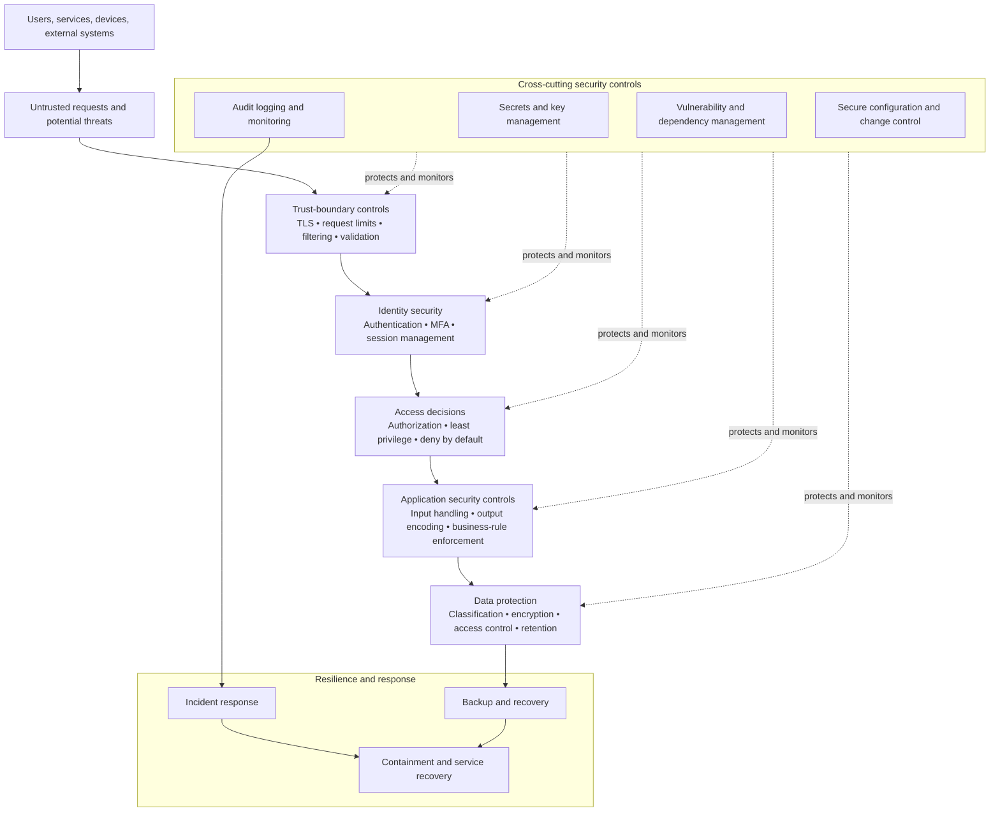
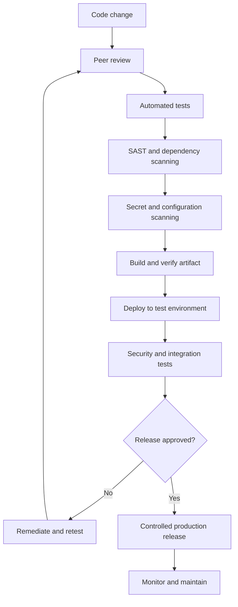

# Universal Secure System Architecture (USSA)

**Version:** 1.0  
**Purpose:** A reusable, technology-independent security architecture baseline for software projects.

> This document defines the security architecture only. It does not prescribe the application's frontend, backend, database schema, technology stack, or general system-component design.

The architecture is a reusable baseline, not a guarantee that one fixed set of controls is sufficient for every project. Each project must adapt the controls to its assets, threats, data sensitivity, operating environment, and applicable legal or regulatory requirements.

---

## 1. Foundational security principles

Every project using this architecture should be designed around the following principles.

1. **Zero Trust:** Do not automatically trust a user, device, service, request, or network connection. Verify identity, authorization, and relevant context before granting access.
2. **Defense in Depth:** Protect important assets with multiple complementary controls so that one failed control does not expose the entire system.
3. **Least Privilege:** Give each identity and service only the permissions required to perform its legitimate tasks.
4. **Secure by Default:** Use restrictive defaults. Access should be denied unless it is explicitly permitted.
5. **Fail Securely:** When a security check or dependency fails, do not silently bypass the control or grant additional access.
6. **Privacy by Design:** Collect, process, retain, and expose only the data needed for the stated purpose.
7. **Separation of Duties:** Separate sensitive responsibilities and administrative permissions where practical.
8. **Continuous Verification:** Reassess security as the software, dependencies, infrastructure, and threat environment change.

---

## 2. Security architecture model

The following model describes security controls and trust boundaries. It is intentionally independent of any particular application-component architecture.



### Architecture requirements

- Every trust boundary must be identified and documented.
- Every sensitive action must have an explicit authorization decision.
- Security controls must be enforced at the trusted side of a boundary, not solely by an untrusted client.
- Security events must be observable without logging secrets or unnecessary sensitive data.
- Secrets, cryptographic keys, and security configuration must be protected independently of ordinary application data.
- Recovery and incident response must be designed before production deployment.

---

## 3. The 15 security pillars

These pillars form the reusable security baseline. Apply each pillar according to the features and risks present in the project.

### Pillar 01 — Identity and authentication

**Objective:** Verify the identity of every user, service, device, or other actor that needs access.

**Required controls:**

- Use a maintained authentication mechanism or trusted identity provider where appropriate.
- Protect registration, login, logout, account recovery, and identity verification processes.
- Require multi-factor authentication (MFA) for administrators and other high-risk accounts; use it for users where the risk warrants it.
- Protect against credential stuffing, brute-force attempts, and automated login abuse through rate limiting, progressive delays, and risk-based controls.
- Secure session creation, renewal, expiration, and revocation.
- Re-authenticate or require step-up authentication for sensitive operations when appropriate.
- Define secure identity lifecycle processes, including account creation, suspension, recovery, and removal.
- Avoid account-enumeration leaks in authentication and recovery responses.

**Password storage:** If the application stores passwords, hash them using a purpose-built password-hashing algorithm such as Argon2id, with unique salts and parameters configured using current guidance. Never store plaintext passwords or use fast general-purpose hashes such as ordinary SHA-256 for password storage.

**Security rule:** Never treat a supplied user ID, email address, username, or token-shaped string as proof of authentication.

### Pillar 02 — Authorization and access control

**Objective:** Ensure authenticated identities can perform only explicitly permitted actions on authorized resources.

**Required controls:**

- Enforce least privilege and deny-by-default authorization.
- Use Role-Based Access Control (RBAC), Attribute-Based Access Control (ABAC), or a suitable combination.
- Check permissions at the resource/object level and function/action level.
- Separate ordinary, privileged, and administrative capabilities.
- Review and revoke permissions when roles or responsibilities change.
- Apply tenant or organizational isolation in multi-tenant systems.
- Protect sensitive operations with additional authorization or approval where required.
- Test for privilege escalation and insecure direct object references.

**Security rule:** Authorization must be checked by a trusted server-side component for every sensitive action. Hiding a control in the user interface is not authorization.

### Pillar 03 — Input validation and output protection

**Objective:** Prevent untrusted data from changing application behavior or being interpreted as executable content.

Treat all external data as untrusted, including form fields, URL parameters, request bodies, headers, cookies, uploaded files, messages, imported data, and third-party responses.

**Required controls:**

1. Validate against explicit allow-lists and schemas wherever practical.
2. Enforce type, format, length, range, and size limits.
3. Normalize data consistently before security-sensitive comparisons.
4. Use context-aware output encoding and safe rendering.
5. Use parameterized queries rather than building database statements through string concatenation.
6. Avoid passing untrusted input to operating-system commands, interpreters, or query languages.
7. Protect file paths and resource names against traversal and unauthorized access.
8. Reject malformed or unexpected input safely.
9. Validate data received from external services before using it.

**Security rule:** Client-side validation supports usability; trusted server-side validation enforces security.

### Pillar 04 — API and communication security

**Objective:** Protect service interfaces from unauthorized use, abuse, manipulation, and data exposure.

**Required controls:**

- Authenticate API clients where authentication is required.
- Enforce endpoint-level and object-level authorization.
- Validate request and response schemas.
- Apply request-size limits, timeouts, rate limits, and resource quotas.
- Configure Cross-Origin Resource Sharing (CORS) with explicit origins when browser cross-origin access is needed; do not use permissive wildcard settings with credentials.
- Apply Cross-Site Request Forgery (CSRF) protections when browser authentication relies on automatically attached credentials such as cookies.
- Protect sensitive operations against replay where applicable.
- Issue, scope, rotate, and revoke API credentials securely.
- Return safe error messages without exposing internal implementation details.
- Validate responses and redirects from third-party services.
- Monitor unusual API usage and resource-consumption patterns.

Use the OWASP API Security Top 10 to review common API risks, including broken object-level authorization, broken authentication, excessive resource consumption, and unsafe consumption of APIs.

### Pillar 05 — Data storage security

**Objective:** Prevent unauthorized access, modification, disclosure, or destruction of stored information.

**Required controls:**

| Control | Baseline requirement |
|---|---|
| Network exposure | Keep data stores private by default; expose them only through approved access paths. |
| Authentication | Require strong identities and credentials for data-store access. |
| Authorization | Use least-privilege accounts and narrowly scoped permissions. |
| Encryption | Protect sensitive data at rest and in transit. |
| Query safety | Use parameterized queries and safe data-access methods. |
| Backups | Encrypt and restrict access to backup copies. |
| Auditing | Record access to sensitive data and privileged data operations. |
| Environment separation | Separate development, testing, and production data and credentials. |
| Recovery | Regularly test restoration and data consistency. |
| Retention | Define retention, archival, and deletion requirements. |

Additional controls:

- Do not run an application using a database-owner or administrator account.
- Separate runtime identities from migration and maintenance identities.
- Restrict bulk exports and administrative operations.
- Enforce tenant boundaries in every relevant data-access path.
- Use transactions and integrity constraints for operations that must remain consistent.
- Avoid copying production personal or confidential data into development environments unless it is appropriately protected and authorized.

### Pillar 06 — Encryption and cryptographic security

**Objective:** Protect confidentiality and integrity using established cryptographic mechanisms.

**Data in transit:**

- Use correctly configured TLS for network communication.
- Validate certificates and hostnames.
- Disable obsolete protocols and weak cryptographic configurations.
- Protect service-to-service communication according to its trust and risk level.

**Data at rest:**

- Encrypt sensitive databases, storage volumes, backups, and exported data.
- Consider field-level encryption for particularly sensitive values when warranted.
- Ensure access to encryption functions and keys is restricted and audited.

**Key management:**

- Use a dedicated Key Management Service (KMS), Hardware Security Module (HSM), or equivalent managed solution when appropriate.
- Keep keys separate from the data they protect.
- Restrict key use by identity, purpose, and environment.
- Define key creation, storage, rotation, revocation, backup, and recovery procedures.
- Never hardcode cryptographic keys or commit them to source control.

Use established algorithms and well-maintained cryptographic libraries. Do not design custom encryption algorithms.

**Important distinctions:** Passwords should be password-hashed, not reversibly encrypted. Encryption does not replace authorization. A valid TLS certificate does not prove that an application or service is trustworthy.

### Pillar 07 — Application and business-logic security

**Objective:** Ensure that application operations cannot be manipulated to bypass security rules or business constraints.

**Required controls:**

- Validate all requests and enforce authorization before performing protected operations.
- Enforce business rules in trusted application logic, not only in the client.
- Protect transactions and state changes against tampering and race conditions.
- Validate ownership and permission for every object being accessed or changed.
- Use safe exception handling and avoid exposing stack traces or internal details to users.
- Apply resource limits and timeouts to expensive operations.
- Handle background tasks and asynchronous messages as untrusted input.
- Prevent unsafe deserialization and arbitrary code or command execution.
- Protect privileged operations with explicit checks and audit records.
- Keep security-sensitive logic centralized and consistent where practical.

**Security rule:** A user must not be able to bypass a business rule by calling an endpoint directly, changing a request parameter, replaying a request, or modifying client-side state.

### Pillar 08 — Client-side and interface security

**Objective:** Reduce attacks against browser, desktop, and mobile clients while ensuring that the client is never treated as the ultimate security authority.

**For browser-based clients:**

- Prevent Cross-Site Scripting (XSS) through safe rendering, contextual output encoding, and careful handling of untrusted HTML.
- Deploy a restrictive Content Security Policy (CSP) appropriate to the application.
- Use secure HTTP headers and HSTS for HTTPS sites.
- Configure cookies with appropriate `Secure`, `HttpOnly`, and `SameSite` attributes.
- Apply CSRF protections when required by the authentication model.
- Avoid exposing secrets or privileged credentials in client-side code.
- Avoid storing sensitive authentication material in browser storage where safer approaches are available.
- Clear sensitive client-side state on logout and account changes.

**For desktop clients:**

- Sign application releases and verify update authenticity and integrity.
- Use operating-system credential stores for secrets where available.
- Restrict local file permissions and protect sensitive local data.
- Secure inter-process communication and local service interfaces.

**For mobile clients:**

- Use platform-backed secure storage for sensitive credentials.
- Request only necessary operating-system permissions.
- Validate deep links and external intents.
- Protect network communication and sensitive local data.

**Security rule:** Client-side controls are useful defense-in-depth measures, but authorization and critical security decisions must be enforced by trusted components.

### Pillar 09 — Network and infrastructure security

**Objective:** Limit the paths through which attackers can reach sensitive services and resources.

**Required controls:**

- Segment networks and define trust zones based on sensitivity and function.
- Apply default-deny inbound firewall rules and explicitly permit required traffic.
- Restrict outbound traffic where practical, especially for sensitive or isolated workloads.
- Keep databases, management interfaces, and internal services private by default.
- Restrict administrative access through approved, strongly authenticated paths.
- Patch operating systems, runtimes, network services, and infrastructure components.
- Harden servers, virtual machines, containers, and cloud configurations.
- Monitor relevant network activity and unexpected outbound connections.
- Apply DDoS protections proportionate to the system's exposure and availability requirements.
- Verify identity and authorization for service-to-service access; network location alone must not grant trust.

**Container and workload hardening:**

- Run workloads as non-root where possible.
- Drop unnecessary Linux capabilities.
- Restrict writable filesystems and mounted host resources.
- Use trusted and maintained images; pin versions or digests where appropriate.
- Apply CPU, memory, process, and execution limits.
- Restrict workload network access.
- Do not place production secrets inside container images.

### Pillar 10 — Secrets management

**Objective:** Prevent credentials and other secrets from being exposed, misused, or retained longer than necessary.

Examples include database credentials, API keys, OAuth client secrets, signing keys, encryption keys, cloud credentials, and service passwords.

**Required controls:**

1. Store secrets in a dedicated secrets manager or protected platform facility.
2. Restrict access by identity, role, environment, and purpose.
3. Encrypt secrets in transit and at rest.
4. Rotate and revoke secrets according to risk and provider capabilities.
5. Prefer short-lived credentials and workload identity where supported.
6. Audit secret access and administrative changes.
7. Keep development, testing, and production secrets separate.
8. Have a documented process for responding to exposed credentials.

Never commit secrets to source control. Do not expose them through logs, error messages, client bundles, debug endpoints, screenshots, or build artifacts.

### Pillar 11 — Logging, monitoring, and detection

**Objective:** Make security-relevant activity observable and enable timely detection of suspicious behavior.

**Record appropriate security events, including:**

- Successful and failed authentication.
- Authorization failures.
- Privilege and role changes.
- Account recovery and security-setting changes.
- Sensitive data access or export.
- Administrative actions.
- Security configuration changes.
- Policy violations and suspicious API activity.
- Unexpected failures affecting security controls.

**Monitor for:**

- Repeated authentication failures.
- Unusual access patterns or locations, where relevant and privacy-appropriate.
- Sudden traffic or resource-use spikes.
- Unexpected data transfers.
- Privilege escalation attempts.
- Unusual background activity.
- Unexpected outbound network connections.
- Abnormal access to sensitive data.

**Logging requirements:**

- Use structured, centralized logs.
- Restrict log access and protect log integrity.
- Define retention periods and deletion procedures.
- Synchronize system clocks where event correlation requires it.
- Configure alerts with clear ownership and escalation paths.
- Avoid logging passwords, tokens, private keys, or unnecessary personal information.

### Pillar 12 — File and data handling security

**Objective:** Prevent malicious or unauthorized data from compromising the system or exposing stored information.

When accepting files or external data:

- Define file-type allow-lists and size limits.
- Verify content using more than the filename extension; inspect signatures and content types where appropriate.
- Generate safe storage names rather than trusting user-supplied paths.
- Store uploads outside public execution paths where practical.
- Apply access controls to stored files and downloads.
- Scan files for malware where the risk justifies it.
- Quarantine suspicious files until they are approved or safely handled.
- Prevent path traversal and unsafe file parsing.
- Set retention and deletion rules.

**Secure data lifecycle:**

1. **Collection:** Collect only data necessary for the defined purpose.
2. **Validation:** Validate, normalize, and classify incoming data.
3. **Processing:** Restrict access and protect sensitive operations.
4. **Storage:** Apply access controls and encryption appropriate to the data.
5. **Transmission:** Use protected communication channels.
6. **Retention:** Keep data only for an approved period.
7. **Deletion:** Delete data according to the defined policy and the capabilities of the storage system and backups.

### Pillar 13 — Backup, resilience, and disaster recovery

**Objective:** Maintain or restore essential services and data after failure, attack, or accidental destruction.

**Required controls:**

- Automate backups according to business and technical recovery requirements.
- Encrypt backups and restrict access to them.
- Use separate backup credentials and access paths.
- Consider immutable or offline backup copies for high-impact data.
- Monitor backup completion and integrity.
- Test restoration regularly, including application-level consistency.
- Document recovery procedures and responsibilities.
- Protect backup systems from the same credentials and failure domains as production where practical.

Define:

- **Recovery Point Objective (RPO):** The maximum acceptable amount of data loss, expressed as time.
- **Recovery Time Objective (RTO):** The target time to restore an acceptable level of service.

RPO and RTO must be selected through business-impact and risk analysis; they are not universal fixed values.

### Pillar 14 — Secure development and software supply chain

**Objective:** Identify and prevent vulnerabilities throughout design, development, build, release, and maintenance.

**Required controls:**

- Protect source repositories and enforce appropriate branch protections.
- Require code review for sensitive changes.
- Run automated tests and security checks in CI/CD.
- Use Static Application Security Testing (SAST).
- Use Software Composition Analysis (SCA) for third-party dependencies.
- Scan repositories and build systems for exposed secrets.
- Scan container images and infrastructure configuration where applicable.
- Track dependency versions, vulnerabilities, and updates.
- Generate and maintain a Software Bill of Materials (SBOM) when appropriate.
- Verify build-artifact integrity and provenance; sign artifacts where supported.
- Protect deployment credentials and restrict production deployment permissions.
- Track vulnerabilities through remediation and retesting.

**Recommended release flow:**



### Pillar 15 — Incident response and security recovery

**Objective:** Ensure the organization can detect, contain, investigate, and recover from security incidents.

Prepare and rehearse procedures for:

1. Detection and reporting.
2. Triage and severity assessment.
3. Containment.
4. Evidence preservation and investigation.
5. Eradication of the cause.
6. Recovery and validation.
7. Post-incident review and improvement.

The architecture should support, where applicable:

- Session and token revocation.
- Credential and key rotation.
- Account suspension.
- Network or service isolation.
- Emergency configuration changes.
- Deployment rollback.
- Evidence preservation.
- Backup restoration.
- Notification and escalation to responsible parties.

Document incident roles, communication paths, decision authority, and recovery priorities before an incident occurs.

---

## 4. Security design and threat-modeling process

Perform this process before implementation and repeat it when major features, integrations, data types, or trust boundaries change.

### Step 1 — Identify assets

Identify what must be protected, including:

- User and service identities.
- Credentials, tokens, and cryptographic keys.
- Personal, confidential, and regulated information.
- Business-critical records and operations.
- Source code and build artifacts.
- Administrative capabilities.
- Availability-critical services.

### Step 2 — Classify data

Use a classification scheme appropriate to the project. A simple starting point is:

| Classification | Examples | Typical protection |
|---|---|---|
| Public | Public documentation and published information | Integrity and availability |
| Internal | Internal configuration and non-public operational information | Restricted access |
| Confidential | Customer or business-sensitive information | Strong access controls and encryption |
| Restricted | Credentials, private keys, and highly sensitive records | Strict access, specialized protection, and auditing |

Adapt the scheme to the organization's policies and legal obligations.

### Step 3 — Identify trust boundaries and attack surfaces

Document where data or control passes between different trust levels. Include user input, external services, administrative interfaces, file processing, network connections, and privileged operations.

### Step 4 — Perform threat modeling

Use STRIDE as an initial threat-identification method:

| Threat | Meaning | Example |
|---|---|---|
| **S — Spoofing** | Pretending to be another identity | Account impersonation |
| **T — Tampering** | Unauthorized modification | Changing transaction data |
| **R — Repudiation** | Denying an action | Denying a sensitive operation |
| **I — Information Disclosure** | Exposing protected information | Unauthorized data access |
| **D — Denial of Service** | Making a service unavailable | Resource exhaustion |
| **E — Elevation of Privilege** | Gaining unauthorized permissions | A normal user gaining administrative access |

For each threat, record:

1. The affected asset.
2. The attacker capability or entry point.
3. The vulnerable trust boundary or control.
4. The likelihood and impact.
5. Existing controls.
6. Required mitigation.
7. Residual risk and its owner.

Do not mark a threat as resolved merely because a generic control exists. Verify that the control addresses the specific attack scenario.

### Step 5 — Select and verify controls

Choose controls based on risk, implement them, and define how each one will be tested. Record exceptions and residual risks explicitly.

---

## 5. Universal security rules

These rules should be treated as non-negotiable defaults unless a documented architecture decision explains an exception.

1. **Never trust client-side input.** Validate and authorize data on the trusted side.
2. **Never expose sensitive data stores unnecessarily.** Keep them private and restrict access paths.
3. **Never store plaintext passwords.** Use a dedicated password-hashing algorithm.
4. **Never hardcode secrets.** Use protected secrets management.
5. **Never grant unnecessary permissions.** Enforce least privilege and deny by default.
6. **Never rely on frontend authorization.** Enforce permissions at trusted enforcement points.
7. **Never silently bypass a failed security control.** Fail securely and alert where appropriate.
8. **Never deploy unverified changes.** Use review, testing, and controlled releases.
9. **Never assume backups are usable.** Test restoration and recovery.
10. **Never leave security events unmonitored.** Collect relevant logs and configure actionable alerts.
11. **Never trust third-party data blindly.** Validate responses, callbacks, files, and integrations.
12. **Never leave vulnerabilities unmanaged.** Prioritize, remediate, document, and retest them.

---

## 6. Security implementation and release gates

Use these gates to verify that the security architecture is implemented and operating as intended.

### Gate 1 — Before development

- [ ] Assets and sensitive data identified.
- [ ] Data classification defined.
- [ ] Trust boundaries and attack surfaces documented.
- [ ] Threat model completed.
- [ ] Authentication and authorization requirements defined.
- [ ] Security requirements and acceptance criteria documented.

### Gate 2 — During development

- [ ] Authentication and session controls implemented.
- [ ] Server-side authorization implemented for protected operations.
- [ ] Input validation and output protection implemented.
- [ ] Secure data access and cryptographic controls implemented.
- [ ] Secrets stored outside source code and client bundles.
- [ ] Safe error handling and security logging implemented.

### Gate 3 — Before staging

- [ ] Code analysis performed.
- [ ] Dependencies scanned.
- [ ] Secret scanning completed.
- [ ] API and authorization tests completed.
- [ ] Data-store permissions reviewed.
- [ ] Infrastructure and container configuration scanned where applicable.

### Gate 4 — Before production

- [ ] Security requirements tested and results recorded.
- [ ] No unresolved critical vulnerabilities remain, unless handled through a formally authorized exception.
- [ ] Access control and tenant-isolation tests passed where applicable.
- [ ] Production secrets and keys are configured securely.
- [ ] Logging, monitoring, and alerting are active.
- [ ] Backup restoration and recovery procedures have been tested.
- [ ] Incident response and rollback procedures are documented.
- [ ] Production release has an authorized approval.

### Gate 5 — After production

- [ ] Security events and vulnerabilities are continuously monitored.
- [ ] Dependencies and infrastructure are maintained.
- [ ] Access permissions are reviewed periodically.
- [ ] Security assessments and penetration tests are performed according to risk.
- [ ] Incident response readiness is tested.
- [ ] Backup and recovery tests are repeated.
- [ ] Security architecture is reviewed when the system changes materially.

A failed critical security gate should block production deployment until the issue is corrected or a formally authorized, time-bounded, documented risk exception is approved.

---

## 7. Reference standards and frameworks

Use established standards to guide implementation and verification. They complement this architecture; none replaces project-specific threat modeling or risk assessment.

| Standard / framework | How to use it | Official reference |
|---|---|---|
| **OWASP Application Security Verification Standard (ASVS)** | Turn application security requirements into verifiable controls and tests. | https://asvs.owasp.org/ |
| **NIST Cybersecurity Framework (CSF) 2.0** | Organize cybersecurity risk management around Govern, Identify, Protect, Detect, Respond, and Recover. | https://www.nist.gov/cyberframework |
| **NIST Secure Software Development Framework (SSDF)** | Integrate secure practices into the software development lifecycle. | https://csrc.nist.gov/pubs/sp/800/218/final |
| **OWASP Software Assurance Maturity Model (SAMM)** | Assess and improve security practices across governance, design, implementation, verification, and operations. | https://owaspsamm.org/model/ |
| **OWASP API Security Top 10** | Review common risks affecting API implementations. | https://owasp.org/www-project-api-security/ |
| **OWASP Cheat Sheet Series** | Apply practical implementation guidance for common application security controls. | https://cheatsheetseries.owasp.org/ |

---

## 8. Applying USSA to a new project

For every new project, keep the 15 pillars as the baseline, then tailor the controls using this short security-only specification:

```text
PROJECT SECURITY PROFILE

1. ASSETS AND DATA
   - What information and capabilities must be protected?
   - How sensitive is each asset?

2. IDENTITIES AND ACCESS
   - Who or what can access the system?
   - What actions may each identity perform?
   - Which actions require additional verification or approval?

3. TRUST BOUNDARIES AND ATTACK SURFACES
   - Where does untrusted data enter?
   - Which external services or users are trusted, and why?
   - Where are privileged operations performed?

4. THREATS AND RISKS
   - What are the credible attack scenarios?
   - What are their likelihood and impact?
   - Which risks require mitigation, transfer, avoidance, or acceptance?

5. SECURITY CONTROLS
   - Which USSA pillars apply?
   - Which controls are mandatory for this project?
   - Who owns each control?

6. VERIFICATION
   - How will each control be tested?
   - What evidence proves that it works?
   - What findings must be fixed before release?

7. OPERATIONS AND RESPONSE
   - What must be monitored?
   - Who responds to incidents?
   - How are credentials revoked, services contained, and data recovered?

8. RESIDUAL RISK
   - What risks remain?
   - Who has authority to accept them?
   - When will accepted risks be reviewed?
```

---

## Final principle

**USSA is the default security baseline, not a substitute for security engineering.** Keep the foundational principles and 15 pillars consistent, but adapt the threat model, implementation details, and verification depth to each project's actual risks. Security must be designed, tested, monitored, and maintained throughout the system's lifecycle.
