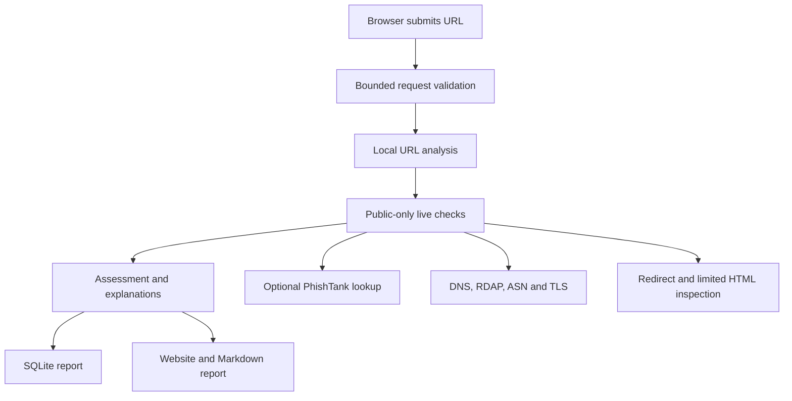

<div align="center">

# 🔎 Link Safety

### Pause before you click.

A transparent link-screening tool that checks suspicious URL patterns and selected public-web signals before you open a link.

<p>
  
  
  
  
</p>

</div>

---

> [!WARNING]
> **Link Safety is an early prototype.** Its score is not calibrated, and no result can guarantee that a link is safe. Treat each result as a set of signals to review—not as a safety certification.

## ✨ Overview

Links can disguise their destination through misspellings, encoded text, redirects, and convincing page content. **Link Safety** helps make those clues easier to review by showing what each check found, explaining why it matters, and identifying checks that could not complete.

### What it offers

| | Capability | Details |
|:--:|---|---|
| 🎯 | **URL analysis** | Checks suspicious formatting, lookalike names, unusual encoding, risky file types, and redirect clues. |
| 🌐 | **Live intelligence** | Performs bounded checks against public DNS, registry and ASN context, TLS, redirects, and returned page HTML. |
| 🧪 | **Phishing reputation** | Offers an optional PhishTank lookup. The exact submitted URL is sent to PhishTank when this lookup runs. |
| 📊 | **Readable results** | Presents a score, verdict, individual findings, a results chart, and an animated scan experience. |
| 📄 | **Report export** | Lets users copy or download a Markdown report. |
| 🔐 | **Report storage** | Uses SQLite, short report retention, and token-protected report retrieval. |
| 🐍 | **Python backend** | Uses a Python API while keeping the browser interface in HTML, CSS, and JavaScript. |

This is a learning-stage screening tool—not a full anti-phishing service, antivirus product, or guarantee that a destination is safe.

---

## 📚 Contents

- [🚀 Getting started](#-getting-started)
- [🧭 Using the scanner](#-using-the-scanner)
- [⚙️ Configuration](#️-configuration)
- [🧠 How it works](#-how-it-works)
- [📡 API reference](#-api-reference)
- [🛡️ Security and privacy](#️-security-and-privacy)
- [🧪 Tests](#-tests)
- [🗂️ Project structure](#️-project-structure)
- [📖 Documentation](#-documentation)
- [📌 Project details](#-project-details)

---

## 🚀 Getting started

### Requirements

- **Python 3.13 or newer**
- **[uv](https://docs.astral.sh/uv/)** for the isolated environment and locked dependencies
- PowerShell on Windows, or a shell with `uv` available on `PATH`

### Run locally

Open a terminal in the project directory.

**1. Create your local environment file** (only when you do not already have one):

```powershell
if (-not (Test-Path .env)) { Copy-Item .env.example .env }
```

**2. Install the locked dependencies:**

```powershell
uv sync --locked
```

**3. Start the server:**

```powershell
uv run python server.py
```

**4. Open the application:**

<http://127.0.0.1:3000>

By default, the server binds to `127.0.0.1`, making it available only from the same computer. Stop the server with `Ctrl+C`.

---

## 🧭 Using the scanner

1. Open the local website and select **Scan a link**.
2. Enter a complete public `http://` or `https://` URL.
3. Wait for the checks to finish, then review the individual findings.
4. Copy the report as Markdown or download the `.md` file for later reference.

### Understanding the result

| Status | Meaning |
|---|---|
| `clear` | That check found no obvious issue in the data it examined. It does **not** guarantee that the destination is safe. |
| `warning` | The check found a signal that deserves attention. |
| `pending` | The check has not completed yet. |
| `error` | The check could not complete successfully. |
| `blocked` | The check was blocked by the application's safety policy. |

> [!CAUTION]
> **Do not submit secret-bearing URLs.** Avoid links containing password-reset codes, private access tokens, session identifiers, or other secrets. A scan may contact the destination. DNS resolvers receive the hostname, registry services receive domain or IP information, and PhishTank receives the exact URL when its optional lookup runs.

Some checks may be unavailable when a provider blocks a request or does not publish the required data. Unavailable checks are not evidence that a link is safe.

---

## ⚙️ Configuration

Settings are read from `.env` and the process environment. Keep real keys in `.env` or a secrets manager, and **never commit secrets**.

<details>
<summary><strong>View environment variables and defaults</strong></summary>

| Setting | Default | Description |
|---|---:|---|
| `NODE_ENV` | `development` | Runtime mode: `development`, `test`, or `production`. The name remains for compatibility with the existing local configuration. |
| `PORT` | `3000` | Local HTTP port. |
| `BIND_ADDRESS` | `127.0.0.1` | Network interface to listen on. Keep it local during development. |
| `ALLOWED_HOSTS` | `127.0.0.1,localhost` | Accepted HTTP Host names. Wildcards are rejected. |
| `DATABASE_PATH` | `./var/link-safety.sqlite` | SQLite database path. |
| `MAX_BODY_BYTES` | `8192` | Maximum JSON request body size. |
| `MAX_URL_LENGTH` | `4096` | Maximum submitted URL length. |
| `RATE_LIMIT_WINDOW_MS` | `60000` | Rate-limit window in milliseconds. |
| `RATE_LIMIT_MAX_REQUESTS` | `20` | Requests allowed per client address during the window. |
| `MAX_CONCURRENT_SCANS` | `2` | Maximum number of scans running at once in one process. |
| `DATA_RETENTION_DAYS` | `30` | Report retention period, from 1 to 3650 days. |
| `PHISHTANK_APP_KEY` | empty | Optional PhishTank key. It may increase the provider's request limit. |

</details>

---

## 🧠 How it works

### Scan pipeline



### The five stages

1. **Validate the request.** The API accepts a JSON object containing only a `url` field. It checks request size and URL length, requires HTTP or HTTPS, and rejects credentials, invalid hosts, private IP literals, and non-standard ports.
2. **Analyze the URL locally.** Rules look for user-info masking, punycode, common brand-like strings, deep subdomains, encoded payload patterns, risky file extensions, and redirect parameters.
3. **Check public signals.** The server can query PhishTank, public DNS, RDAP domain registration data, IP registry and ASN context, TLS, redirects, and a capped amount of page HTML. It follows no more than five redirects and validates every new destination. It does not run page scripts or open a browser.
4. **Explain the assessment.** Each check reports `clear`, `warning`, `pending`, `error`, or `blocked`. Warnings affect the signal score. Missing or failed checks are counted as unavailable—not as clear.
5. **Store a short-lived report.** SQLite stores the hostname, scheme, findings, score, verdict, timestamps, and a hash of a random report token. The raw URL path, query, fragment, and token are not stored.

### What the checks cover

| Check area | What it examines | Important limitation |
|---|---|---|
| **URL structure** | Masking, punycode, known brand-like text, deep subdomains, encoding, file extensions, and redirect clues. | Heuristics can miss attacks or flag harmless links. |
| **Phishing reputation** | The exact submitted URL with PhishTank, when available. | Provider rate limits or security challenges can make the result unavailable. A no-match does not prove safety. |
| **Domain and network context** | Public DNS, RDAP registration and IP registry records, and Team Cymru BGP origin. | Registry data is context—not proof of abuse or precise physical location. Some suffixes or addresses have no available data. |
| **TLS** | HTTPS certificate chain and hostname validation. | HTTPS protects the connection; it does not prove that a website is trustworthy. |
| **Redirects and page content** | Up to five redirects and at most 384 KiB of HTML, checking password forms, form destinations, urgency, brand clues, hidden controls, and simple response differences. | It does not execute JavaScript, render a browser, or detect every client-side redirect or visual trick. |
| **Display label** | Explains that no link label was supplied for comparison. | The input accepts a URL only; it cannot compare the URL with copied message text. |

### Score and verdict logic

The score is an **uncalibrated URL signal score**, not the probability that a link is safe.

- Three or more warning signals produce `high`.
- One or two warning signals produce `caution`.
- No warnings with unavailable checks produce `incomplete`.
- `clear` is used only when all checks that ran completed without a warning.

Always review the detailed findings. Do not use the score as the only basis for deciding whether to open a link.

---

## 📡 API reference

| Method | Endpoint | Purpose |
|:--:|---|---|
| `POST` | `/api/analyze` | Compatibility route used by the bundled website. |
| `POST` | `/api/v1/scans` | Creates a report and returns its one-time bearer token. |
| `GET` | `/api/v1/scans/{scan_id}` | Reads a stored report using `Authorization: Bearer <access_token>`. |
| `GET` | `/health/live` | Reports that the process is running. |
| `GET` | `/health/ready` | Checks whether SQLite responds. |

---

## 🛡️ Security and privacy

### Implemented security controls

- The server binds to loopback by default, restricts accepted Host names, disables proxy-header trust, and does not enable cross-origin requests.
- Request bodies, URL length, request rate, concurrent scans, outbound time, redirects, and response bytes are limited.
- Live checks accept standard HTTP/HTTPS ports only. Every resolved A and AAAA address must be public, and each outbound socket connects to an address that was checked. Redirects pass through the same policy again.
- HTTPS verifies the certificate chain and hostname. The server sends no cookies or credentials and does not execute remote JavaScript.
- SQLite uses ordered migrations, foreign keys, strict tables, transactions, defensive settings where available, parameterized queries, and owner-only file/sidecar permissions on POSIX.
- Stored report access uses a random 256-bit token. The database contains only its SHA-256 hash, and token comparison is constant time.
- Logs include a request ID and route label but omit the URL, body, query, client IP, and bearer token.
- Reports expire after 30 days by default.

### Data sharing at a glance

| Recipient | Information shared during a scan |
|---|---|
| **PhishTank** | The exact submitted URL, when the optional lookup runs. |
| **DNS resolvers** | The hostname being resolved. |
| **Public destination** | Bounded page and TLS requests. |
| **IANA/RIR RDAP and Team Cymru** | Domain or IP details used for registry and network context. |

The full URL is used in memory during the scan and returned to the browser for the immediate result. Stored reports retain the hostname and findings, not the path, query, or fragment. Avoid scanning URLs that contain secrets.

### Known limitations and production considerations

- This is an early prototype, not a safety guarantee or production security certification.
- The score has not been tested or calibrated against a representative phishing dataset.
- Provider access and registry coverage vary. Unavailable lookups remain marked as unavailable rather than being shown as clean.
- Static HTML checks can miss JavaScript-driven behavior and may produce false alarms.
- The in-process rate limiter and local SQLite database are for a single process; they do not support horizontal scaling.
- Application-level SSRF protections are not a substitute for an OS-level network egress firewall. Public deployment needs an isolated inspection worker and strict egress rules.
- Production also needs HTTPS ingress, shared rate limiting, encrypted backups, restore testing, monitoring, incident ownership, and an independent security review.

---

## 🧪 Tests

Run the Python backend test suite from the project directory:

```powershell
uv run python -m unittest discover -s tests -p "test_*.py" -v
```

The suite covers URL policy, IP transition-address rejection, SSRF-safe DNS and redirects, HTML inspection, SQLite permissions/migrations/token storage, configuration, rate limiting, and the API response contract.

> Passing tests do not certify the application or replace an independent penetration test.

---

## 🗂️ Project structure

```text
backend/link_safety/       Python API, rules, outbound checks, and SQLite adapter
public/                    Browser interface (HTML, CSS, JavaScript)
migrations/                Ordered SQLite schema migrations
tests/                     Python unittest checks
docs/                      Setup, architecture, API, and operations notes
project engineering ideas/  Original project and architecture references
var/                        Local SQLite data (ignored by Git)
archive/                    Preserved Node.js backend from before the migration
```

---

## 📖 Documentation

| Resource | Description |
|---|---|
| [Local setup](docs/development/local-setup.md) | Development environment and startup instructions. |
| [Architecture overview](docs/architecture/overview.md) | High-level system design. |
| [Backend architecture](docs/architecture/backend.md) | Backend components and responsibilities. |
| [Data model](docs/architecture/data.md) | Database structure and stored data. |
| [Security architecture](docs/architecture/security.md) | Security controls and threat considerations. |
| [API contract](docs/api/openapi.yaml) | API specification. |
| [Operations runbook](docs/operations/runbook.md) | Operational guidance. |
| [Architecture decisions](docs/architecture/decisions/) | Recorded architecture decisions. |

---

## 📌 Project details

| | Details |
|---|---|
| **Version** | `0.3.0` |
| **Backend** | Python 3.13+ · FastAPI · Uvicorn |
| **Browser UI** | HTML · CSS · JavaScript |
| **Database** | SQLite (`var/link-safety.sqlite` by default) |
| **Default address** | `127.0.0.1:3000` |
| **License** | No license file is included yet. Add one before inviting reuse. |

### Support the project

If Link Safety has helped you and you would like to support its development, Vodafone Cash transfers in Egypt can be sent to **+201031263934**.

From a Vodafone line, dial `*9*7#`, choose **Money Transfer**, enter the number and amount, then confirm the recipient details. **Never share your wallet PIN.**

---

<div align="center">

**Link Safety** · Pause before you click.

<sub>Built to make link checks easier to understand—not to replace careful judgment.</sub>

</div>
