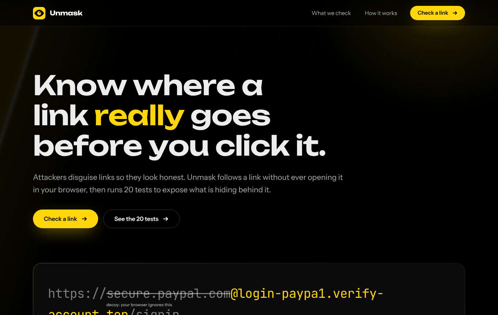
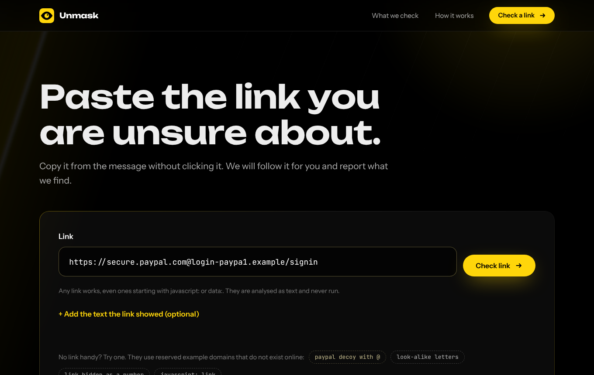
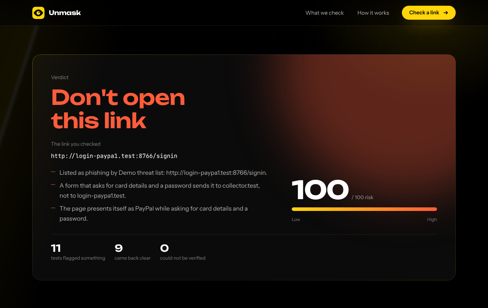
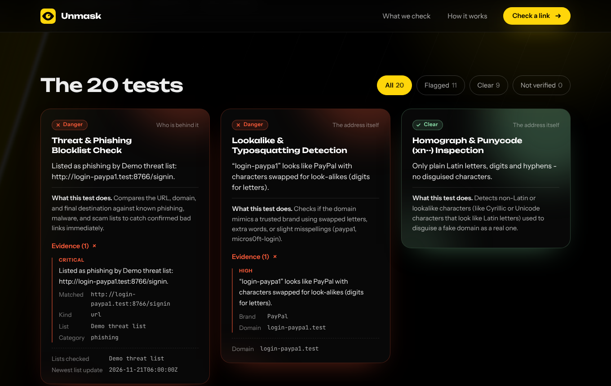

# Unmask: see where a link really goes

Unmask checks a link **without ever opening it in your browser**. Paste a link; the server follows every redirect, reads the page, looks up the domain, certificate and network, and runs **20 tests** that expose phishing, hidden redirects and look-alike domains. You get a verdict, a risk score, the journey the link takes, and for every test: what it does, what it found, and the evidence.



| Paste a link | Read the report |
|---|---|
|  |  |



## Quick start

**Windows (PowerShell)**
```powershell
.\scripts\setup.ps1          # virtualenv + pinned dependencies + .env + database
.\scripts\run.ps1            # open http://127.0.0.1:8000
```
**macOS / Linux**
```bash
./scripts/setup.sh && ./scripts/run.sh
```
Needs Python 3.11+ (tested on 3.12). No database server, no Node.js, no build step.

**No internet? Try demo mode:** `.\.venv\Scripts\python.exe scripts\demo_server.py` then open http://127.0.0.1:8765. It runs the real app against a local fixture "internet" and prints ready-made links (phishing-style page, short link, open redirect, fake-PDF program, page that hides from scanners).

**From the terminal:** `$env:PYTHONPATH="src"; .\.venv\Scripts\python.exe -m interfaces.cli scan "https://paypa1-login.example/signin" --details`

## The 20 tests

| Where it looks | Tests |
|---|---|
| **The address itself** | Look-alike & typosquatting · Homograph & punycode · User-info (`@`) masking · Subdomain spoofing · URL obfuscation & encoding · Dangerous schemes · Port & path anomalies |
| **Where it really goes** | Shortener & redirect unwrapping · Open redirect & cross-domain jump · Final destination vs. display text |
| **Who is behind it** | Threat & phishing blocklists · Domain age · SSL/TLS certificate · Hosting IP, ASN & geo |
| **What the page does** | Login & credential forms · Form-action mismatch · Brand impersonation & urgency · Hidden elements & overlays · Auto-download triggers · Cloaking & bot-evasion |

Every test is explained in the report and in [`docs/architecture/overview.md`](docs/architecture/overview.md).

**Honest by design.** A test that could not run is shown as **Not verified**, never as clear. "No threats found" is only ever given when enough tests could verify and the page was actually inspected; otherwise the verdict is *Couldn't verify*. The tool reports what its tests find; it cannot prove a link safe.

## How it is built

A modular monolith organised exactly as your four architecture files describe:

```text
src/bootstrap/ modules/{link_analysis,threat_intel}/ interfaces/{api,web,cli}/ workers/ infrastructure/ shared/
tests/ migrations/ config/ scripts/ infra/ assets/ data/ examples/ docs/
```
Python · FastAPI · SQLite · plain HTML/CSS/JavaScript (no framework, no build step, strict CSP). Key ideas: a **browser-faithful URL parser**, an **SSRF-guarded HTTP client** (resolves, validates and pins the IP; never follows redirects blindly), **evidence first, then 20 pure checks** (each unit-tested offline), and **fail honestly** when a source is unavailable. Start at [`docs/architecture/overview.md`](docs/architecture/overview.md).

| Document | Contents |
|---|---|
| [`docs/architecture/backend.md`](docs/architecture/backend.md) | the 14 backend decisions, error contract |
| [`docs/architecture/data.md`](docs/architecture/data.md) | the 15-section data specification |
| [`docs/architecture/security.md`](docs/architecture/security.md) | security profile, STRIDE threat model, release gates |
| [`docs/architecture/decisions/`](docs/architecture/decisions) | 7 architecture decision records |
| [`docs/api/README.md`](docs/api/README.md) | API guide (+ generated `openapi.json`) |
| [`docs/development/`](docs/development) | setup, adding a check |
| [`docs/operations/`](docs/operations) | deployment, runbook, threat feeds and licences |

## The web interface

Three pages as specified: **Home** (what it fixes), **Process** (paste a link), **Analysis** (the report). Yellow is the primary colour, black the secondary, white the last; thin lines of soft light; every analysis box carries a blurred colour glow; content fades in and out as you scroll; buttons and boxes float in a slow infinite loop; text appears as slow, soft, blurred typing; scrolling is soft and slow. Accessibility: keyboard operable, screen-reader friendly, high contrast, respects `prefers-reduced-motion`, and a footer **Pause animations** switch.

Status colours (green, orange-red) are the only additions to the brief's palette, because a security report needs them; each status also has an icon and a word, so colour is never the only signal. They are variables in `src/interfaces/web/styles/tokens.css`.

## Configuration

Everything is an `UNMASK_*` environment variable, validated at start-up (see [`.env.example`](.env.example), every option is explained). Unsafe production settings are refused. Optional integrations (Google Safe Browsing, URLhaus) are **off by default** and send the checked links to that provider when enabled.

## Threat data and licences: please read

The blocklist test uses public feeds downloaded to your server (`python -m interfaces.cli update-feeds`): the **OpenPhish community feed is for non-commercial use only**, and **Spamhaus DROP requires credit to The Spamhaus Project**. Details and the full terms links: [`docs/operations/feeds.md`](docs/operations/feeds.md). Fonts (Unbounded, Instrument Sans, JetBrains Mono) are self-hosted under the SIL Open Font License ([`assets/fonts/LICENSES.md`](assets/fonts/LICENSES.md)). `LICENSE` contains an MIT text with a placeholder for the copyright holder: fill it in or replace it.

## Testing

`.\scripts\test.ps1` (or `./scripts/test.sh`) runs lint with security rules, the generated-file checks, and **188 tests**: URL parser and all 20 checks (each with a "must flag" and a "must not flag" case), scoring and lifecycle, SQLite and migrations, feed safety, the real fetcher against a local server, a real TLS handshake, failure isolation, end-to-end scans through the HTTP API, the API contract, and security regressions (SSRF, CSP and headers, privacy of logs, limits). All offline.

**Not covered by automated tests:** live calls to third-party services (RDAP, Team Cymru DNS, feed downloads, Safe Browsing/URLhaus), certificate validation against real public CAs, and performance under load. Their adapters are unit/integration tested against recorded-format samples and local servers; verify them once on your own network (`update-feeds`, `scan` a real link).

## Rename / restyle

The name appears in `src/interfaces/web/pages/*.html`, `assets/images/`, the API title (`bootstrap/main.py`) and docs: search for "Unmask". Colours, fonts and spacing are in `styles/tokens.css`.
