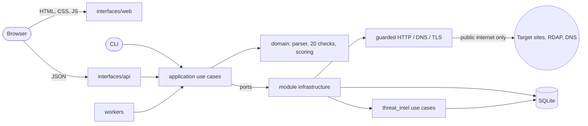

# Architecture overview

Unmask follows your four architecture files. This page shows how each one shows up in the repository; the other pages in this folder are the filled-in templates they ask for.

| Source file | Where it is applied |
|---|---|
| Universal Project Directory Architecture (UPDA) | The repository layout (see below) |
| Universal Software Backend Architecture (USBA) | [`backend.md`](backend.md): the 14 per-project decisions; modules, use cases, ports, error contract, workers |
| Universal Software Data Architecture (USDA) | [`data.md`](data.md): the 15-section data specification; migrations and constraints in `/migrations` |
| Universal Software Security Architecture (USSA) | [`security.md`](security.md): the security profile, threat model and release gates |

## What the system does

A person pastes a link. The server (never the person's browser) analyses it with 20 tests and returns a verdict, a risk score, the redirect journey, and for every test: what it does, what it found, and the evidence. A test that cannot run is reported as **not verified**, never as clear.

## Repository layout (UPDA mapping)

```text
src/bootstrap/            composition root: settings, dependency wiring, app factory
src/modules/link_analysis/  the core capability (scans and the 20 checks)
    domain/               pure rules: URL parser, checks, scoring, Scan aggregate. No I/O, no frameworks
    application/          use cases: submit, run analysis, queries; evidence collector
    ports/                interfaces for everything that touches the outside world
    infrastructure/       adapters: SQLite repository, page fetcher, HTML parser, DNS/TLS/RDAP/ASN, blocklists
src/modules/threat_intel/   downloads and serves public threat feeds (owns its tables)
src/interfaces/api/       HTTP API: routes, handlers, schemas, middleware
src/interfaces/web/       the three pages (pages/, components/, state/, api_client/, styles/)
src/interfaces/cli/       serve, migrate, scan, update-feeds, import-feed, purge, check-config
src/workers/              background job runner, handlers, schedules
src/infrastructure/       shared technical adapters: guarded HTTP, SQLite, logging, metrics, queue, rate limiter
src/shared/               errors, small contracts, utilities
tests/                    unit, integration, contract, end_to_end, security, fixtures
migrations/               versioned SQL
config/defaults/          reference data (brands, lists, lexicons), feed catalogue; config/schemas/ validates them
assets/                   self-hosted fonts and images
scripts/ infra/ docs/ data/ examples/ .github/
```

Two small, deliberate deviations from the generic layout: `interfaces/web/styles/` (stylesheets belong to the presentation layer and have no other home in the schema), and a git-ignored `var/` folder for runtime state in development (the schema forbids runtime data in `data/`). Reference data lives under `config/defaults/reference/` because it is non-secret configuration with defaults and a schema, which is exactly what `config/` is for.

## Components



Dependency direction: `interfaces → application → domain ← infrastructure`. The domain imports no framework, no database, no HTTP library.

## How a scan flows

```mermaid
sequenceDiagram
  participant B as Browser
  participant A as API
  participant Q as Queue
  participant W as Worker
  participant E as Evidence collector
  B->>A: POST /api/v1/scans (url, optional label)
  A->>A: validate, rate-limit, persist scan (queued)
  A->>Q: enqueue scan id
  A-->>B: 202 + scan id
  W->>Q: take scan id
  W->>E: start (7 evidence sources run concurrently, each isolated)
  E-->>W: journey, browser-view journey, DNS, hosting, TLS, registration, blocklist
  W->>W: run 20 pure checks as their evidence arrives; save each result
  W->>W: score, verdict, complete
  loop every ~1s
    B->>A: GET /api/v1/scans/{id}
    A-->>B: partial results, then the final report
  end
```

**Evidence first, then pure checks.** The collector gathers facts (what the redirect chain is, what the page contains, who owns the domain). Each check is a pure function of `(parsed URL, optional label, evidence, reference data)`, so all 20 are unit-tested with no network. A source that fails becomes `Evidence.missing(reason)`; the check then reports *not verified*.

## The 20 checks

| # | Id | Looks at | Evidence it needs |
|---|---|---|---|
| 1 | `blocklist` | known bad lists | blocklist |
| 2 | `lookalike` | typosquatting vs ~130 brands | none |
| 3 | `homograph` | Unicode/punycode disguise | none |
| 4 | `redirect_chain` | shorteners, hops | journey |
| 5 | `open_redirect` | trusted site bouncing elsewhere | journey |
| 6 | `userinfo_masking` | `@` decoys, backslash tricks | none |
| 7 | `subdomain_spoofing` | brand inside subdomains | none |
| 8 | `obfuscation` | encoding, Base64, odd IP notation | none |
| 9 | `dangerous_scheme` | `javascript:`, `data:`, handlers | none |
| 10 | `domain_age` | registration date (RDAP) | registration, journey |
| 11 | `tls_certificate` | HTTPS and certificate | tls, journey |
| 12 | `hosting_risk` | IP, ASN, abuse networks | dns, hosting, journey |
| 13 | `port_path_anomaly` | ports, misleading extensions | journey |
| 14 | `login_form` | password/OTP/card/seed fields | journey (+ registration) |
| 15 | `form_action_mismatch` | where forms submit | journey |
| 16 | `brand_urgency` | impersonation plus pressure | journey |
| 17 | `hidden_elements` | invisible overlays and frames | journey |
| 18 | `auto_download` | executables, archives, smuggling | journey (both views) |
| 19 | `cloaking` | scanner view vs browser view | both journeys |
| 20 | `display_mismatch` | label vs landing page | journey |

Implementation: `src/modules/link_analysis/domain/checks/` (`address.py`, `journey.py`, `reputation.py`, `behavior.py`, ordered in `catalog.py`).

## Scoring

Each finding has a severity (info, low, medium, high, critical) worth 0 / 5 / 15 / 35 / 75 points. Points combine as `100 × (1 − Π(1 − p/100))`, so several weak signals add up without ever passing 100, and one critical finding is enough for "dangerous". Verdicts: below 10 safe, below 30 caution, below 65 suspicious, otherwise dangerous. A verdict of "safe" is downgraded to **inconclusive** when fewer than 70% of tests could verify or when a web page was never inspected.

## Extension points

- New check: [`../development/adding-a-check.md`](../development/adding-a-check.md).
- New brand, list entry or lure phrase: edit the JSON under `config/defaults/reference/` (validated at start-up).
- New threat feed: add an entry to `config/defaults/feeds.json`.
- JavaScript-rendered pages: add a renderer adapter behind the page-fetcher port (see ADR 0005 for why it is not included).
